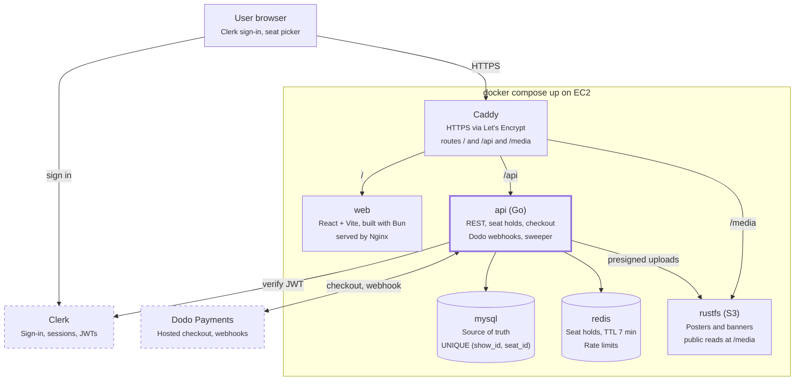
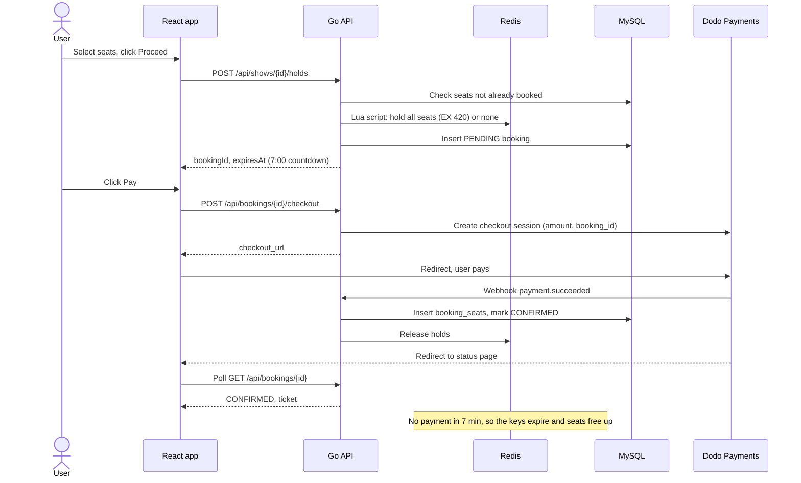

# Tango

A BookMyShow-style movie ticket booking app. Pick a city, browse and search movies by date, choose a showtime, select your seats, and they are held for **7 minutes** while you pay. Nobody else can book them in that window.

Built with React, Go, MySQL, Redis and RustFS, with Clerk for auth and Dodo Payments for checkout. The whole stack starts with one `docker compose up`.

---

## Features

- **Browse and search** movies by city, date, language, genre and format
- **Movie details** with showtimes grouped by theater
- **Interactive seat map** with seat categories, live availability and auto-selection of adjacent seats
- **7-minute seat hold** backed by Redis TTLs, with a countdown on screen
- **Secure payments** via Dodo Payments hosted checkout, confirmed by webhook
- **No double booking**: atomic Redis holds plus a MySQL unique constraint per show and seat
- **Automatic refunds** if a late payment arrives after the seats were taken
- **My bookings** with QR-code tickets
- **Admin panel** to manage movies, posters, theaters, screen layouts and shows
- **Self-hosted**: runs on a single EC2 instance or any VPS with automatic HTTPS

## Architecture



Only ports 80 and 443 are public, and both go to Caddy. The Go API is the only service that talks to MySQL, Redis, RustFS, Clerk and Dodo. The browser talks only to Caddy, Clerk's sign-in widget and Dodo's hosted checkout page. Dashed boxes are external SaaS. Named Docker volumes keep MySQL, Redis and RustFS data across restarts.

### Booking flow



### How the seat hold works

- Each held seat is a Redis key `hold:{showId}:{seatId}` holding the booking id, with a 420-second TTL.
- A Lua script checks and sets every requested seat in one atomic step, so two users can never hold the same seat.
- When the TTL expires, Redis deletes the keys and the seats become available again. No cron job is needed.
- The webhook, not the browser redirect, confirms a booking. Confirmation inserts rows into `booking_seats`, which has `UNIQUE (show_id, seat_id)`. If a late payment hits a seat someone else already took, the insert fails and the payment is refunded.

## Tech stack

| Layer | Technology |
| --- | --- |
| Frontend | React 19, Vite, TypeScript, Bun, Tailwind CSS, shadcn/ui, TanStack Query, React Router |
| Backend | Go 1.23+, chi, sqlc, golang-migrate, slog |
| Auth | Clerk (`@clerk/clerk-react`, `clerk-sdk-go/v2`) |
| Payments | Dodo Payments (checkout sessions + webhooks) |
| Database | MySQL 8.4 |
| Cache / holds | Redis 7 |
| Object storage | RustFS (S3-compatible) |
| Proxy / TLS | Caddy 2 |
| Runtime | Docker Compose |

## Project structure

```text
tango/
├── api/                        # Go backend
│   ├── cmd/server/main.go
│   ├── internal/
│   │   ├── http/               # router, handlers, middleware (auth, rate limit)
│   │   ├── booking/            # seat holds, booking service
│   │   ├── payments/           # Dodo client + webhook handler
│   │   ├── catalog/            # cities, theaters, movies, shows, search
│   │   ├── storage/            # RustFS (S3) client, presigned uploads
│   │   └── db/                 # sqlc-generated queries
│   ├── migrations/
│   └── Dockerfile
├── web/                        # React + Vite + TypeScript (Bun)
│   ├── src/
│   ├── nginx.conf
│   └── Dockerfile
├── deploy/Caddyfile
├── scripts/                    # seed.sql, init-bucket.sh, backup.sh
├── docker-compose.yml
├── docker-compose.override.yml # dev only: exposes DB, Redis, RustFS ports
└── .env.example
```

## Getting started

### Prerequisites

- [Docker](https://docs.docker.com/get-docker/) with Docker Compose
- A [Clerk](https://clerk.com) application (publishable + secret key)
- A [Dodo Payments](https://dodopayments.com) account in test mode (API key + webhook secret)
- For local development outside Docker: [Bun](https://bun.sh) 1.x and Go 1.23+

### 1. Clone and configure

```bash
git clone https://github.com/<your-username>/tango.git
cd tango
cp .env.example .env
```

Fill in `.env`:

```bash
DOMAIN=localhost
APP_BASE_URL=https://localhost

MYSQL_DATABASE=tango
MYSQL_USER=app
MYSQL_PASSWORD=change-me
MYSQL_ROOT_PASSWORD=change-me-too
DB_DSN=app:change-me@tcp(mysql:3306)/tango?parseTime=true&loc=UTC

REDIS_ADDR=redis:6379
REDIS_PASSWORD=change-me

S3_ENDPOINT=http://rustfs:9000
S3_ACCESS_KEY=change-me
S3_SECRET_KEY=change-me-long-secret
S3_BUCKET=posters
PUBLIC_MEDIA_URL=https://localhost/media

CLERK_PUBLISHABLE_KEY=pk_test_...
CLERK_SECRET_KEY=sk_test_...

DODO_PAYMENTS_API_KEY=...
DODO_PAYMENTS_WEBHOOK_KEY=...
DODO_PAYMENTS_ENVIRONMENT=test_mode

SEAT_HOLD_SECONDS=420
```

### 2. Start everything

```bash
docker compose up -d --build
```

Then initialise storage and seed data:

```bash
./scripts/init-bucket.sh                                          # creates the posters bucket + public-read policy
docker compose exec -T mysql mysql -uapp -p tango < scripts/seed.sql
```

Open **https://localhost**. Caddy serves a locally trusted certificate in development.

### 3. Set up Dodo Payments

1. In the Dodo dashboard, create a one-time product called **Movie ticket** with **pay-what-you-want enabled**. The API sends each booking's server-computed total as the `amount`.
2. Under **Developer → Webhooks**, add `https://<your-domain>/api/webhooks/dodo`.
3. For local testing, expose the API with a tunnel and register that URL as a test-mode webhook:

```bash
cloudflared tunnel --url http://localhost:8080
```

### Local development without Docker

```bash
# Frontend
cd web
bun install
bun run dev

# Backend (MySQL, Redis and RustFS still run in Docker via the override file)
cd api
go run ./cmd/server
```

## API overview

| Method | Path | Auth | Purpose |
| --- | --- | --- | --- |
| GET | `/api/health` | — | Health check |
| GET | `/api/cities` | — | List cities |
| GET | `/api/movies?city=&date=&q=&genre=&lang=` | — | Browse and search movies |
| GET | `/api/movies/{slug}` | — | Movie details |
| GET | `/api/movies/{slug}/shows?city=&date=` | — | Showtimes by theater |
| GET | `/api/shows/{id}/seats` | optional | Seat map with availability |
| POST | `/api/shows/{id}/holds` | user | Hold seats for 7 minutes |
| DELETE | `/api/bookings/{id}/hold` | user | Release held seats |
| POST | `/api/bookings/{id}/checkout` | user | Create Dodo checkout session |
| GET | `/api/bookings/{id}` | user | Booking status and ticket |
| GET | `/api/me/bookings` | user | Booking history |
| POST | `/api/webhooks/dodo` | signature | Payment events |
| POST | `/api/admin/uploads/presign` | admin | Presigned poster upload |

## Deployment (EC2 or any VPS)

1. Launch an Ubuntu 24.04 instance (t3.medium recommended, 30 GB disk) and attach an **Elastic IP**.
2. Open only ports **22** (your IP), **80** and **443** in the security group.
3. Install Docker: `curl -fsSL https://get.docker.com | sh`.
4. Point an `A` record for your domain (for example `tango.yourdomain.com`) at the Elastic IP.
5. Switch Clerk and Dodo to **production / live** keys and add the live webhook URL.
6. Clone the repo, create `.env` with `DOMAIN=tango.yourdomain.com` and strong random secrets, then:

```bash
docker compose up -d --build
```

Caddy obtains a Let's Encrypt certificate automatically on the first request.

**Updating:**

```bash
git pull && docker compose up -d --build
```

**Backups:** schedule a nightly `mysqldump` and an `mc mirror` of the RustFS bucket to off-server storage, and enable EBS snapshots.

The RustFS console is bound to `127.0.0.1:9001`. Reach it over an SSH tunnel:

```bash
ssh -L 9001:localhost:9001 ubuntu@<server-ip>
```

## Roadmap

- [ ] Real-time seat updates with Server-Sent Events
- [ ] Email tickets with PDF attachments
- [ ] Coupons and discounts
- [ ] "Tango Pass" subscription with fee-free bookings
- [ ] Food and beverage add-ons

## License

MIT