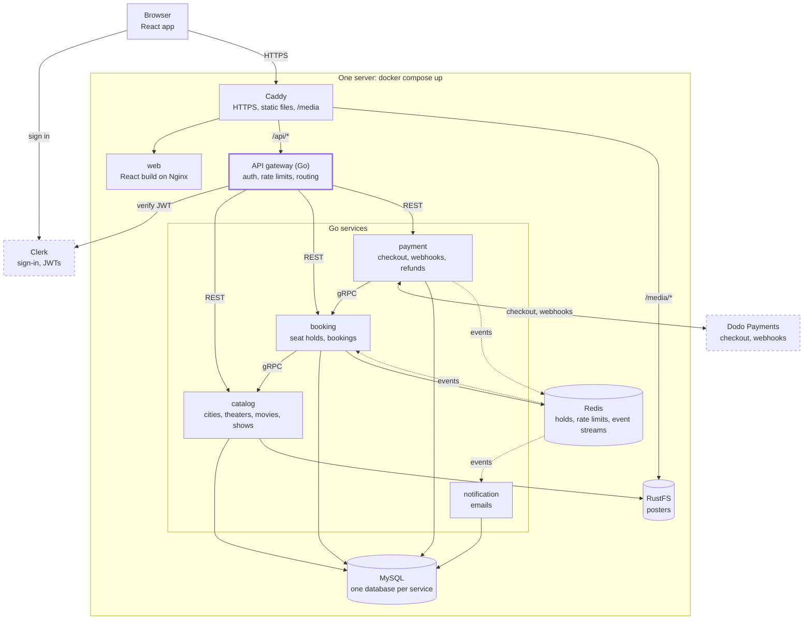
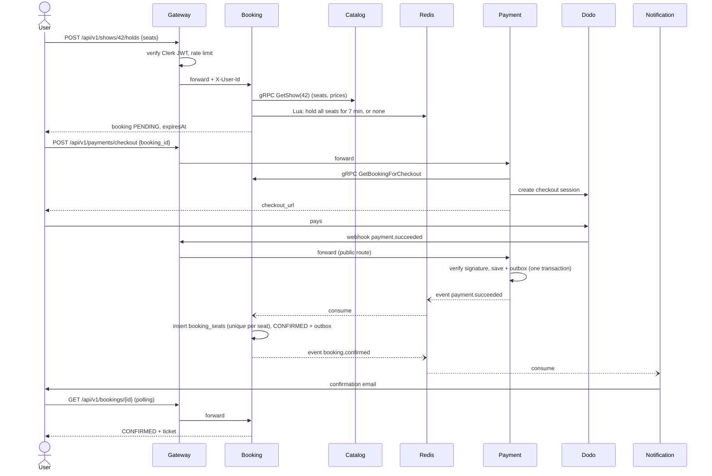
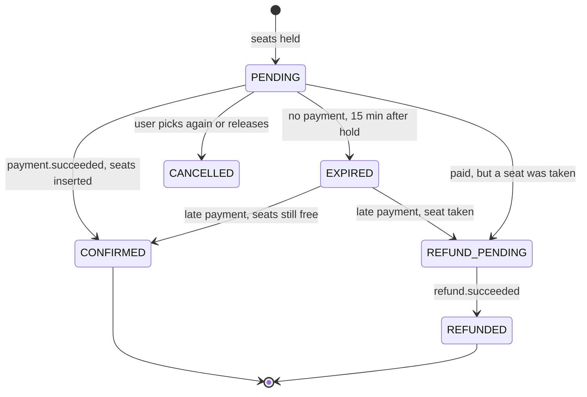

# Tango — Project Walkthrough and Go Microservices Tutorial

> A BookMyShow-style movie booking platform built with a Go API gateway, Go microservices, React, MySQL, Redis and RustFS. Users sign in with Clerk and pay with Dodo Payments.
>
> This guide teaches you Go from zero by building Tango step by step. It also explains _why_ each production practice exists, so you can defend every decision in an interview.

**How to use this guide**

- Read Part 1 once, to understand what you are building and why it is shaped this way.
- Part 2 is a Go crash course with examples taken from Tango. Skim it now, come back when code looks strange.
- Parts 3–11 are the build, in the order you should do it. Every part ends with a "Checkpoint" so you know it works before moving on.
- Part 12 is your interview preparation: a pitch, a walkthrough script and answers to the questions you will be asked.

Code marked **✅ tested** was compiled, checked with `go vet` and covered by passing tests (with Go's race detector) while writing this guide. Code that depends on third-party libraries (Redis, MySQL driver, Clerk, gRPC) is written against their documented APIs; if a library has changed, its README is the source of truth.

---

## Contents

1. [What we are building](#part-1--what-we-are-building)
2. [Go crash course (the parts Tango uses)](#part-2--go-crash-course)
3. [Set up the repository](#part-3--set-up-the-repository)
4. [The shared platform packages](#part-4--the-shared-platform-packages)
5. [The API gateway](#part-5--the-api-gateway)
6. [The catalog service](#part-6--the-catalog-service)
7. [The booking service and the 7-minute hold](#part-7--the-booking-service-and-the-7-minute-hold)
8. [Events, the outbox and the payment service](#part-8--events-the-outbox-and-the-payment-service)
9. [The notification service](#part-9--the-notification-service)
10. [Frontend, Docker Compose and local development](#part-10--frontend-docker-compose-and-local-development)
11. [Testing, observability, CI/CD and deployment](#part-11--testing-observability-cicd-and-deployment)
12. [Interview guide](#part-12--interview-guide)
13. [Glossary](#part-13--glossary)

---

## Part 1 — What we are building

### The product

1. Pick a city. Browse "now showing" and search movies by name, date, language and genre.
2. Open a movie, pick a date and a showtime at a theater.
3. Choose how many seats, then pick them on a seat map.
4. Click **Proceed**: the seats are **held for 7 minutes**. Nobody else can take them.
5. Pay on Dodo Payments' hosted checkout.
6. Get a ticket with a QR code, plus a confirmation email.

The hard problems hide in steps 4 and 5: thousands of people clicking the same seats at the same moment, payments that arrive late or twice, and services that crash halfway through. Most of this guide is about solving those properly.

### The architecture



| Component        | Owns                                                                    | Talks to                                          |
| ---------------- | ----------------------------------------------------------------------- | ------------------------------------------------- |
| **Caddy**        | HTTPS certificates, serving the React build and posters                 | gateway, web, RustFS                              |
| **API gateway**  | The public API surface: authentication, rate limiting, routing          | catalog, booking, payment (HTTP)                  |
| **catalog**      | Cities, theaters, screens, seat layouts, movies, shows, prices, posters | MySQL `catalog` DB, RustFS                        |
| **booking**      | Seat holds, bookings, the seat map, confirming seats                    | MySQL `booking` DB, Redis, catalog (gRPC), events |
| **payment**      | Checkout sessions, Dodo webhooks, refunds                               | MySQL `payment` DB, Dodo, booking (gRPC), events  |
| **notification** | Confirmation and refund emails                                          | MySQL `notification` DB, events, email provider   |

### Three rules that shape everything

1. **Each service owns its data.** Only the booking service reads or writes the `booking` database. Others ask booking (gRPC) or listen to its events. This is what lets services change and deploy independently.
2. **Synchronous calls only when you need an answer now; events for everything else.** "What does this show cost?" needs an answer now (gRPC). "A payment succeeded" is a fact others react to in their own time (an event).
3. **Assume everything fails and everything happens twice.** Networks drop, webhooks retry, containers restart. Every handler is idempotent (safe to run twice) and every external call has a timeout.

### Why microservices for this project?

Be honest about this in interviews: **for a small team, a well-structured monolith is usually the right first step.** Tango uses microservices because:

- **Different load profiles.** On a blockbuster release, seat holds spike 100× while the catalog barely changes. Booking can scale on its own.
- **Different failure blast radius.** If the email provider is down, bookings must still work. A separate notification service that consumes events makes that automatic.
- **Different security sensitivity.** Only the payment service holds payment API keys.
- **Learning goal.** The patterns here (gateway, service-to-service auth, outbox, sagas, idempotent consumers) are what larger companies run in production.

The services sit in **one repository** (a monorepo) and **one Go module**, but each builds into its own Docker image and runs as its own process. That gives the operational benefits of microservices with the convenience of one codebase.

### The booking flow end to end



---

## Part 2 — Go crash course

Go is small on purpose. You can learn the whole language in a week; the rest is libraries and habits. Install Go 1.25 or newer from [go.dev/dl](https://go.dev/dl), then work through [A Tour of Go](https://go.dev/tour) alongside this part.

### 2.1 Packages, modules and visibility

```go
// File: pkg/logx/logx.go
package logx              // every file starts with its package name

import (
	"log/slog"            // standard library
	"os"
)

func New(service string) *slog.Logger { ... }  // Capitalised = exported (public)
func helper() {}                                 // lowercase = private to the package
```

- A **module** is your project (`go.mod` names it: `module github.com/you/tango`).
- A **package** is a folder. You import it by module path + folder: `github.com/you/tango/pkg/logx`.
- Code in an `internal/` folder can only be imported from inside your module. Tango puts each service's code there.
- There are no classes and no `public` keyword: **capital letter = exported**.

### 2.2 Variables, types and structs

```go
var count int                      // zero value: 0
name := "Tango"                    // := declares and infers the type (inside functions only)
const MaxSeatsPerBooking = 10

type Booking struct {              // a struct groups fields (like a class without methods... yet)
	ID          string
	ShowID      int64
	SeatIDs     []int64            // a slice: a growable list
	AmountMinor int64              // money as integers: 35000 paise = ₹350.00
	CreatedAt   time.Time
}

b := Booking{ID: "bk_1", ShowID: 42}
b.SeatIDs = append(b.SeatIDs, 7, 8)
prices := map[string]int64{"standard": 20000, "premium": 35000} // a map: key -> value
```

Every type has a **zero value** (`0`, `""`, `false`, `nil`), so there is no "undefined". Never store money as `float64`: `0.1 + 0.2 != 0.3`. Use integer minor units.

### 2.3 Functions, methods and multiple returns

```go
func add(a, b int) int { return a + b }

// Methods are functions attached to a type. (s *Service) is the "receiver".
func (s *Service) HoldSeats(ctx context.Context, userID string, showID int64, seatIDs []int64) (Booking, error) {
	...
}
```

Functions often return `(result, error)`. That is how Go handles failure.

### 2.4 Errors are values

```go
show, err := s.Catalog.GetShow(ctx, showID)
if err != nil {
	return Booking{}, fmt.Errorf("get show %d: %w", showID, err) // wrap with context
}
```

- No exceptions. You check `err != nil` right where it can happen. It looks verbose; it makes every failure path visible.
- `fmt.Errorf("...: %w", err)` **wraps** an error, adding context while keeping the original.
- `errors.Is(err, ErrNotFound)` checks for a specific error anywhere in the chain; `errors.As(err, &target)` extracts a typed error.

```go
var ErrNotFound = errors.New("booking not found")      // a "sentinel" error

type SeatTakenError struct{ SeatID int64 }               // a typed error carrying data
func (e *SeatTakenError) Error() string { return fmt.Sprintf("seat %d is no longer available", e.SeatID) }

var taken *SeatTakenError
if errors.As(err, &taken) {
	// respond 409 and tell the UI which seat to refresh: taken.SeatID
}
```

`panic` exists, but only for "this can never happen" bugs. Never use it for normal failures.

### 2.5 Interfaces: the key to testable code

An interface lists methods. Any type that has those methods satisfies it automatically. There is no `implements` keyword.

```go
type HoldStore interface {
	Hold(ctx context.Context, showID int64, seatIDs []int64, token string, ttl time.Duration) (bool, int64, error)
	Release(ctx context.Context, showID int64, seatIDs []int64, token string) error
}
```

The booking `Service` depends on `HoldStore`, not on Redis. In production we pass a Redis implementation; in tests we pass an in-memory fake. **"Accept interfaces, return structs"** is the Go proverb behind this. Keep interfaces small and define them where they are _used_.

### 2.6 Pointers

```go
func (s *Service) HoldSeats(...)   // *Service: a pointer; the method can see and change the real struct
b := &Booking{ID: "x"}             // & takes the address of a value
```

Rule of thumb: use pointer receivers (`*T`) for structs that hold dependencies or state. Use values for small immutable data.

### 2.7 `defer`

`defer` runs a call when the function returns, however it returns. Use it for cleanup next to the thing that needs cleaning:

```go
tx, err := db.BeginTx(ctx, nil)
if err != nil { return err }
defer tx.Rollback()      // harmless after Commit; guarantees no leaked transaction on early return

resp, err := client.Do(req)
if err != nil { return err }
defer resp.Body.Close()  // always close HTTP bodies or connections leak
```

### 2.8 `context.Context`: deadlines and cancellation

Every function that does I/O takes `ctx context.Context` as its **first** parameter. A context carries a deadline and a cancel signal. When a user closes the tab, the HTTP server cancels the request's context. Every database query, Redis call and gRPC call made with that context stops too.

```go
ctx, cancel := context.WithTimeout(r.Context(), 2*time.Second)
defer cancel()
err := db.PingContext(ctx) // gives up after 2 seconds
```

Never store a context in a struct. Pass it down.

### 2.9 Goroutines and channels (just enough)

```go
go relay.Run(ctx)       // "go" runs a function concurrently, in a goroutine (very cheap)

errCh := make(chan error, 1)   // a channel passes values between goroutines
go func() { errCh <- srv.ListenAndServe() }()

select {                // wait for whichever happens first
case err := <-errCh:
	return err
case <-ctx.Done():      // shutdown signal
}
```

Shared data touched by several goroutines needs protection: a `sync.Mutex`, `sync/atomic`, or a design where only one goroutine owns it. Always run tests with `-race`; the race detector finds these bugs for you.

### 2.10 JSON and struct tags

```go
type CheckoutSession struct {
	SessionID   string `json:"session_id"`    // tag maps Go field <-> JSON key
	CheckoutURL string `json:"checkout_url"`
	Amount      int64  `json:"amount,omitempty"` // omitted when zero
}
json.NewDecoder(resp.Body).Decode(&out)        // JSON -> struct
json.Marshal(req)                              // struct -> JSON bytes
```

### 2.11 HTTP in the standard library

Since Go 1.22 the built-in router understands methods and path parameters, so Tango needs no web framework:

```go
mux := http.NewServeMux()
mux.HandleFunc("GET /v1/movies/{slug}", func(w http.ResponseWriter, r *http.Request) {
	slug := r.PathValue("slug")
	...
})
```

A **handler** reads the request `r` and writes the response `w`. A **middleware** is a function that wraps a handler to add behaviour (logging, auth) before and after it.

### 2.12 Tests

```go
// File: service_test.go (same folder, name ends in _test.go)
func TestHoldSeats(t *testing.T) {
	tests := []struct {          // "table-driven tests": one table, many cases
		name    string
		seats   []int64
		wantErr error
	}{
		{"no seats", nil, ErrInvalidSeatCount},
		{"too many", make([]int64, 11), ErrInvalidSeatCount},
	}
	for _, tc := range tests {
		t.Run(tc.name, func(t *testing.T) {
			_, err := svc.HoldSeats(ctx, "u1", 42, tc.seats)
			if !errors.Is(err, tc.wantErr) {
				t.Fatalf("err = %v, want %v", err, tc.wantErr)
			}
		})
	}
}
```

Run with `go test ./...` (everything) or `go test -race -run TestHoldSeats ./internal/booking`.

### 2.13 The tools you will use daily

| Command                | Does                                                  |
| ---------------------- | ----------------------------------------------------- |
| `go run ./cmd/gateway` | Compile and run a program                             |
| `go build ./...`       | Compile everything                                    |
| `go test -race ./...`  | Run all tests with the race detector                  |
| `go vet ./...`         | Catch common mistakes                                 |
| `gofmt -w .`           | Format code (there is one official style; no debates) |
| `go mod tidy`          | Add missing / remove unused dependencies              |
| `golangci-lint run`    | Run many linters at once (install separately)         |

---

## Part 3 — Set up the repository

### 3.1 Accounts and tools

1. Install **Go 1.25+**, **Docker Desktop**, **Bun 1.x**, **Git**, and an editor (VS Code with the official Go extension, or GoLand).
2. Install the Go tools:

```bash
go install github.com/golang-migrate/migrate/v4/cmd/migrate@latest  # add: -tags 'mysql'
go install github.com/bufbuild/buf/cmd/buf@latest
go install google.golang.org/protobuf/cmd/protoc-gen-go@latest
go install google.golang.org/grpc/cmd/protoc-gen-go-grpc@latest
# golangci-lint: follow https://golangci-lint.run/welcome/install/
```

3. Create a **Clerk** application (email + Google sign-in) and a **Dodo Payments** account in **test mode**.

### 3.2 Repository layout

```text
tango/
├── go.mod                      # ONE Go module for all services
├── cmd/                        # one tiny main.go per deployable program
│   ├── gateway/main.go
│   ├── catalog/main.go
│   ├── booking/main.go
│   ├── payment/main.go
│   └── notification/main.go
├── internal/                   # each service's private code
│   ├── gateway/
│   ├── catalog/
│   │   ├── migrations/         # SQL files, embedded into the binary
│   │   ├── store.go            # MySQL queries
│   │   ├── service.go          # business rules
│   │   ├── http.go             # REST handlers
│   │   └── grpc.go             # gRPC server for other services
│   ├── booking/
│   ├── payment/
│   └── notification/
├── pkg/                        # shared platform code every service uses
│   ├── config/  logx/  httpx/  health/  events/  outbox/  redisx/  mysqlx/
├── proto/                      # gRPC contracts
│   ├── catalog/v1/catalog.proto
│   └── booking/v1/booking.proto
├── gen/                        # code generated from proto/ (committed)
├── web/                        # React + Vite + TypeScript (Bun)
├── deploy/
│   ├── Caddyfile
│   ├── mysql/init.sh           # creates one database + user per service
│   └── prometheus.yml
├── Dockerfile                  # one Dockerfile, builds any service via --build-arg SERVICE=
├── docker-compose.yml
├── docker-compose.override.yml # dev only
├── buf.yaml  buf.gen.yaml
├── .golangci.yml
├── Makefile
└── .github/workflows/ci.yml
```

**Why this shape?** `cmd/` stays thin (wiring only), `internal/<service>` keeps services from importing each other's code by accident, and `pkg/` holds the boring-but-critical platform code that you write once. Inside each service the code is layered **handler → service → store**. HTTP and gRPC handlers translate requests; the service holds the rules; the store talks to the database. Each layer only knows the one below it.

### 3.3 Initialise

```bash
mkdir tango && cd tango && git init
go mod init github.com/<your-username>/tango
mkdir -p cmd/{gateway,catalog,booking,payment,notification} \
         internal/{gateway,catalog,booking,payment,notification} \
         pkg/{config,logx,httpx,health,events,outbox,redisx,mysqlx} \
         proto/{catalog,booking}/v1 gen deploy/mysql
bun create vite web --template react-ts
```

Add dependencies as you reach the parts that need them (`go get <module>`), then run `go mod tidy`.

### 3.4 Makefile (your command menu)

```makefile
.PHONY: up down logs test lint proto fmt

up:      ## start everything
	docker compose up -d --build
down:
	docker compose down
logs:
	docker compose logs -f --tail=100
test:
	go test -race -count=1 ./...
lint:
	golangci-lint run ./...
fmt:
	gofmt -w . && go mod tidy
proto:
	buf lint && buf generate
```

### Checkpoint 3

`go build ./...` succeeds (even with empty `main` functions) and `bun run dev` inside `web/` opens the Vite page.

---

## Part 4 — The shared platform packages

Every service needs the same plumbing: configuration, logging, an HTTP server that shuts down cleanly, middleware, JSON helpers and health checks. Top companies put this in a shared "platform" layer so every service behaves the same way in production. Write it once, here.

### 4.1 Configuration from environment variables — ✅ tested

Following the [Twelve-Factor App](https://12factor.net/config), configuration lives in environment variables, never in code. The `Env` helper collects **all** problems so a misconfigured service fails at startup with one clear message.

```go
// Package config reads settings from environment variables.
//
// Every service builds its own Config struct with an Env, then calls Err()
// once, so a missing variable fails fast at startup with one clear message
// instead of crashing later in the middle of a request.
package config

import (
	"fmt"
	"os"
	"strconv"
	"strings"
	"time"
)

// Env collects values and remembers every problem it finds.
type Env struct {
	problems []string
}

// Required returns the variable or records it as missing.
func (e *Env) Required(key string) string {
	v := strings.TrimSpace(os.Getenv(key))
	if v == "" {
		e.problems = append(e.problems, key+" is required")
	}
	return v
}

// String returns the variable, or fallback when it is empty.
func (e *Env) String(key, fallback string) string {
	if v := strings.TrimSpace(os.Getenv(key)); v != "" {
		return v
	}
	return fallback
}

// Int parses an integer variable, or returns fallback when it is empty.
func (e *Env) Int(key string, fallback int) int {
	v := strings.TrimSpace(os.Getenv(key))
	if v == "" {
		return fallback
	}
	n, err := strconv.Atoi(v)
	if err != nil {
		e.problems = append(e.problems, key+" must be an integer")
		return fallback
	}
	return n
}

// Duration parses values such as "7m", "30s" or "1h30m".
func (e *Env) Duration(key string, fallback time.Duration) time.Duration {
	v := strings.TrimSpace(os.Getenv(key))
	if v == "" {
		return fallback
	}
	d, err := time.ParseDuration(v)
	if err != nil {
		e.problems = append(e.problems, key+" must be a duration like 30s or 7m")
		return fallback
	}
	return d
}

// List splits a comma-separated variable: "a, b,c" -> ["a" "b" "c"].
func (e *Env) List(key string) []string {
	var out []string
	for _, part := range strings.Split(os.Getenv(key), ",") {
		if p := strings.TrimSpace(part); p != "" {
			out = append(out, p)
		}
	}
	return out
}

// Err reports every problem at once, or nil when the config is valid.
func (e *Env) Err() error {
	if len(e.problems) == 0 {
		return nil
	}
	return fmt.Errorf("invalid configuration: %s", strings.Join(e.problems, "; "))
}
```

Usage in a service:

```go
type Config struct {
	Port    string
	DSN     string
	HoldTTL time.Duration
}

func loadConfig() (Config, error) {
	var env config.Env
	cfg := Config{
		Port:    env.String("PORT", "8080"),
		DSN:     env.Required("DB_DSN"),
		HoldTTL: env.Duration("SEAT_HOLD_TTL", 7*time.Minute),
	}
	return cfg, env.Err()
}
```

### 4.2 Structured logging — ✅ tested

`log/slog` (standard library) writes JSON logs. Every line carries the service name and, in requests, the request id. That turns "grep through text" into "filter by `request_id`".

```go
// Package logx builds the structured JSON logger every service uses.
package logx

import (
	"log/slog"
	"os"
)

// New returns a JSON logger that tags every line with the service name.
// JSON logs can be searched and filtered by tools like Loki, Datadog or CloudWatch.
func New(service string) *slog.Logger {
	level := slog.LevelInfo
	if os.Getenv("LOG_LEVEL") == "debug" {
		level = slog.LevelDebug
	}
	handler := slog.NewJSONHandler(os.Stdout, &slog.HandlerOptions{Level: level})
	return slog.New(handler).With("service", service)
}
```

### 4.3 JSON helpers and one error format — ✅ tested

```go
package httpx

import (
	"encoding/json"
	"errors"
	"net/http"
)

// ErrorBody is the one error shape every Tango API returns:
//
//	{"error": {"code": "seat_unavailable", "message": "Seat F12 was just taken"}}
//
// A stable machine-readable code lets the frontend react without parsing text.
type ErrorBody struct {
	Error ErrorDetail `json:"error"`
}

type ErrorDetail struct {
	Code    string `json:"code"`
	Message string `json:"message"`
}

// WriteJSON sends v as JSON with the given status code.
func WriteJSON(w http.ResponseWriter, status int, v any) {
	w.Header().Set("Content-Type", "application/json")
	w.WriteHeader(status)
	_ = json.NewEncoder(w).Encode(v)
}

// WriteError sends the standard error body.
func WriteError(w http.ResponseWriter, status int, code, message string) {
	WriteJSON(w, status, ErrorBody{Error: ErrorDetail{Code: code, Message: message}})
}

// DecodeJSON reads one JSON object into dst. It rejects bodies over 1 MB,
// unknown fields and trailing data, so clients get a clear 400 for typos.
func DecodeJSON(w http.ResponseWriter, r *http.Request, dst any) error {
	r.Body = http.MaxBytesReader(w, r.Body, 1<<20)
	dec := json.NewDecoder(r.Body)
	dec.DisallowUnknownFields()
	if err := dec.Decode(dst); err != nil {
		return err
	}
	if dec.More() {
		return errors.New("request body must contain a single JSON object")
	}
	return nil
}
```

### 4.4 Middleware: request ids, access logs, panic recovery — ✅ tested

```go
package httpx

import (
	"context"
	"crypto/rand"
	"encoding/hex"
	"log/slog"
	"net/http"
	"runtime/debug"
	"time"
)

// HeaderRequestID carries one id through the gateway and every service,
// so all log lines for a single user action can be found together.
const HeaderRequestID = "X-Request-Id"

type ctxKey struct{}

// Middleware wraps a handler with extra behaviour.
type Middleware func(http.Handler) http.Handler

// Chain applies middlewares so the first one listed runs first (outermost).
func Chain(h http.Handler, mws ...Middleware) http.Handler {
	for i := len(mws) - 1; i >= 0; i-- {
		h = mws[i](h)
	}
	return h
}

// RequestID reuses the caller's X-Request-Id or creates a new one.
func RequestID(next http.Handler) http.Handler {
	return http.HandlerFunc(func(w http.ResponseWriter, r *http.Request) {
		id := r.Header.Get(HeaderRequestID)
		if id == "" || len(id) > 64 {
			id = newID()
		}
		w.Header().Set(HeaderRequestID, id)
		ctx := context.WithValue(r.Context(), ctxKey{}, id)
		next.ServeHTTP(w, r.WithContext(ctx))
	})
}

// RequestIDFrom returns the request id stored by RequestID.
func RequestIDFrom(ctx context.Context) string {
	id, _ := ctx.Value(ctxKey{}).(string)
	return id
}

func newID() string {
	b := make([]byte, 12)
	_, _ = rand.Read(b)
	return hex.EncodeToString(b)
}

// statusRecorder remembers the status code and size a handler wrote.
type statusRecorder struct {
	http.ResponseWriter
	status int
	bytes  int
}

func (s *statusRecorder) WriteHeader(code int) {
	s.status = code
	s.ResponseWriter.WriteHeader(code)
}

func (s *statusRecorder) Write(b []byte) (int, error) {
	if s.status == 0 {
		s.status = http.StatusOK
	}
	n, err := s.ResponseWriter.Write(b)
	s.bytes += n
	return n, err
}

// Unwrap lets http.ResponseController reach the real writer (for Flush etc.).
func (s *statusRecorder) Unwrap() http.ResponseWriter { return s.ResponseWriter }

// AccessLog writes one structured line per request.
func AccessLog(log *slog.Logger) Middleware {
	return func(next http.Handler) http.Handler {
		return http.HandlerFunc(func(w http.ResponseWriter, r *http.Request) {
			start := time.Now()
			rec := &statusRecorder{ResponseWriter: w}
			next.ServeHTTP(rec, r)
			if rec.status == 0 {
				rec.status = http.StatusOK
			}
			log.LogAttrs(r.Context(), slog.LevelInfo, "http_request",
				slog.String("method", r.Method),
				slog.String("path", r.URL.Path),
				slog.Int("status", rec.status),
				slog.Int("bytes", rec.bytes),
				slog.Duration("duration", time.Since(start)),
				slog.String("request_id", RequestIDFrom(r.Context())),
			)
		})
	}
}

// Recoverer turns a panic into a 500 response instead of killing the process.
func Recoverer(log *slog.Logger) Middleware {
	return func(next http.Handler) http.Handler {
		return http.HandlerFunc(func(w http.ResponseWriter, r *http.Request) {
			defer func() {
				if v := recover(); v != nil {
					if v == http.ErrAbortHandler {
						panic(v) // deliberate abort: let net/http handle it
					}
					log.Error("panic recovered",
						"panic", v,
						"stack", string(debug.Stack()),
						"request_id", RequestIDFrom(r.Context()),
					)
					WriteError(w, http.StatusInternalServerError, "internal", "internal server error")
				}
			}()
			next.ServeHTTP(w, r)
		})
	}
}
```

The **request id** is the thread through a distributed system. The gateway creates it, forwards it to services, services forward it on gRPC calls and put it in every log line. When a user reports "my booking failed", you search one id and see the whole story across all services.

### 4.5 An HTTP server with timeouts and graceful shutdown — ✅ tested

```go
package httpx

import (
	"context"
	"errors"
	"log/slog"
	"net/http"
	"time"
)

// NewServer returns an http.Server with timeouts set. The zero-value server
// has no timeouts, so one slow client could hold a connection open forever.
func NewServer(addr string, h http.Handler) *http.Server {
	return &http.Server{
		Addr:              addr,
		Handler:           h,
		ReadHeaderTimeout: 5 * time.Second,
		ReadTimeout:       15 * time.Second,
		WriteTimeout:      30 * time.Second,
		IdleTimeout:       60 * time.Second,
	}
}

// Run serves until ctx is cancelled (Ctrl+C or `docker stop`), then stops
// accepting new requests and waits up to 20 seconds for in-flight ones.
func Run(ctx context.Context, srv *http.Server, log *slog.Logger) error {
	errCh := make(chan error, 1)
	go func() {
		log.Info("http server listening", "addr", srv.Addr)
		if err := srv.ListenAndServe(); err != nil && !errors.Is(err, http.ErrServerClosed) {
			errCh <- err
		}
		close(errCh)
	}()

	select {
	case err := <-errCh:
		return err // the server failed to start, e.g. port already in use
	case <-ctx.Done():
	}

	log.Info("shutting down http server")
	shutdownCtx, cancel := context.WithTimeout(context.Background(), 20*time.Second)
	defer cancel()
	return srv.Shutdown(shutdownCtx)
}
```

**Graceful shutdown** matters during deploys: Docker sends `SIGTERM`, the server stops taking new requests, finishes the ones in flight, then exits. No user sees a half-finished booking because you shipped a new version.

### 4.6 Health checks — ✅ tested

```go
// Package health adds liveness and readiness endpoints to a service.
//
//	/healthz  "is the process alive?"            -> used by Docker to restart it
//	/readyz   "can it do useful work right now?" -> checks MySQL, Redis, ...
package health

import (
	"context"
	"net/http"
	"os"
	"time"

	"github.com/<you>/tango/pkg/httpx"
)

// Check returns nil when a dependency is healthy.
type Check func(ctx context.Context) error

// Register adds /healthz and /readyz to mux.
func Register(mux *http.ServeMux, checks map[string]Check) {
	mux.HandleFunc("GET /healthz", func(w http.ResponseWriter, r *http.Request) {
		httpx.WriteJSON(w, http.StatusOK, map[string]string{"status": "ok"})
	})

	mux.HandleFunc("GET /readyz", func(w http.ResponseWriter, r *http.Request) {
		ctx, cancel := context.WithTimeout(r.Context(), 2*time.Second)
		defer cancel()

		status := http.StatusOK
		result := make(map[string]string, len(checks))
		for name, check := range checks {
			if err := check(ctx); err != nil {
				status = http.StatusServiceUnavailable
				result[name] = err.Error()
				continue
			}
			result[name] = "ok"
		}
		httpx.WriteJSON(w, status, result)
	})
}

// RunProbeIfRequested makes `app -healthcheck` call the service's own
// /healthz and exit 0 or 1. Distroless images have no curl or wget, so this
// is how the Docker HEALTHCHECK works. Call it first thing in main().
func RunProbeIfRequested(port string) {
	if len(os.Args) < 2 || os.Args[1] != "-healthcheck" {
		return
	}
	client := http.Client{Timeout: 2 * time.Second}
	resp, err := client.Get("http://127.0.0.1:" + port + "/healthz")
	if err != nil {
		os.Exit(1)
	}
	resp.Body.Close()
	if resp.StatusCode != http.StatusOK {
		os.Exit(1)
	}
	os.Exit(0)
}
```

- **Liveness** (`/healthz`): "the process is running." If it fails, restart the container.
- **Readiness** (`/readyz`): "dependencies are reachable." If it fails, stop sending traffic but don't restart.

Kubernetes uses exactly these two ideas, so learning them now carries over.

### 4.7 The shape of every `main.go`

All five programs follow the same pattern. Here is the catalog service's:

```go
package main

import (
	"context"
	"database/sql"
	"log/slog"
	"net/http"
	"os"
	"os/signal"
	"syscall"
	"time"

	_ "github.com/go-sql-driver/mysql" // registers the "mysql" driver

	"github.com/<you>/tango/internal/catalog"
	"github.com/<you>/tango/pkg/config"
	"github.com/<you>/tango/pkg/health"
	"github.com/<you>/tango/pkg/httpx"
	"github.com/<you>/tango/pkg/logx"
)

func main() {
	health.RunProbeIfRequested("8080") // Docker healthcheck mode

	log := logx.New("catalog")
	if err := run(log); err != nil {
		log.Error("service stopped with error", "err", err)
		os.Exit(1)
	}
}

// run returns errors instead of calling os.Exit, so deferred cleanup always runs.
func run(log *slog.Logger) error {
	ctx, stop := signal.NotifyContext(context.Background(), os.Interrupt, syscall.SIGTERM)
	defer stop()

	var env config.Env
	dsn := env.Required("DB_DSN")
	if err := env.Err(); err != nil {
		return err
	}

	db, err := sql.Open("mysql", dsn)
	if err != nil {
		return err
	}
	defer db.Close()
	db.SetMaxOpenConns(20)
	db.SetMaxIdleConns(10)
	db.SetConnMaxLifetime(5 * time.Minute)

	if err := catalog.Migrate(dsn); err != nil {
		return err
	}

	store := catalog.NewStore(db)
	svc := catalog.NewService(store)

	mux := http.NewServeMux()
	catalog.RegisterHTTP(mux, svc)
	health.Register(mux, map[string]health.Check{"mysql": db.PingContext})

	go catalog.ServeGRPC(ctx, ":9090", svc, log) // internal API for other services

	handler := httpx.Chain(mux, httpx.RequestID, httpx.AccessLog(log), httpx.Recoverer(log))
	return httpx.Run(ctx, httpx.NewServer(":8080", handler), log)
}
```

### Checkpoint 4

`go vet ./pkg/...` is clean. Write a one-line `main.go` that serves only `health.Register` and run it: `curl localhost:8080/healthz` returns `{"status":"ok"}`.

---

## Part 5 — The API gateway

The gateway is the **only** service the internet can reach (through Caddy). It does three jobs and nothing else:

1. **Authentication**: verify the Clerk session token once, at the edge.
2. **Rate limiting**: stop one client from flooding expensive endpoints.
3. **Routing**: send `/api/v1/...` to the right service, from an explicit allowlist.

It holds **no business logic**. If you find yourself writing `if booking.Status == ...` in the gateway, it belongs in a service.

### 5.1 Auth: verify once, pass identity on — ✅ tested

```go
package gateway

import (
	"context"
	"errors"
	"net/http"
	"strings"

	"github.com/<you>/tango/pkg/httpx"
)

// Access says who may call a route.
type Access int

const (
	Public   Access = iota // anyone
	Optional               // anyone; identify the user if a token is sent
	User                   // signed-in users only
	Admin                  // admins only
)

// Identity is who the caller is, after the token was verified.
type Identity struct {
	UserID string
	Role   string // "user" or "admin"
}

// Verifier checks a session token. Production uses Clerk; tests use a fake.
type Verifier interface {
	Verify(ctx context.Context, token string) (Identity, error)
}

var ErrInvalidToken = errors.New("invalid token")

type identityKey struct{}

func withIdentity(ctx context.Context, id Identity) context.Context {
	return context.WithValue(ctx, identityKey{}, id)
}

// IdentityFrom returns the verified caller, if there is one.
func IdentityFrom(ctx context.Context) (Identity, bool) {
	id, ok := ctx.Value(identityKey{}).(Identity)
	return id, ok
}

func bearerToken(r *http.Request) (string, bool) {
	h := r.Header.Get("Authorization")
	token, found := strings.CutPrefix(h, "Bearer ")
	if !found || token == "" {
		return "", false
	}
	return token, true
}

// requireAccess verifies the token (when needed) and enforces the route's Access.
func requireAccess(v Verifier, access Access, admins map[string]bool, next http.Handler) http.Handler {
	return http.HandlerFunc(func(w http.ResponseWriter, r *http.Request) {
		if access == Public {
			next.ServeHTTP(w, r)
			return
		}

		token, ok := bearerToken(r)
		if !ok {
			if access == Optional {
				next.ServeHTTP(w, r)
				return
			}
			httpx.WriteError(w, http.StatusUnauthorized, "unauthenticated", "sign in to continue")
			return
		}

		id, err := v.Verify(r.Context(), token)
		if err != nil {
			httpx.WriteError(w, http.StatusUnauthorized, "invalid_token", "your session has expired, sign in again")
			return
		}

		id.Role = "user"
		if admins[id.UserID] {
			id.Role = "admin"
		}
		if access == Admin && id.Role != "admin" {
			httpx.WriteError(w, http.StatusForbidden, "forbidden", "admins only")
			return
		}

		next.ServeHTTP(w, r.WithContext(withIdentity(r.Context(), id)))
	})
}
```

### 5.2 The Clerk verifier

Clerk issues a short-lived **JWT** (a signed JSON token) to the browser. The gateway checks the signature against Clerk's public keys (**JWKS**) and reads the user id from the `sub` claim. Keys are cached so we don't call Clerk on every request.

```go
// internal/gateway/clerk.go
package gateway

import (
	"context"
	"sync"
	"time"

	"github.com/clerk/clerk-sdk-go/v2"
	"github.com/clerk/clerk-sdk-go/v2/jwks"
	"github.com/clerk/clerk-sdk-go/v2/jwt"
)

type ClerkVerifier struct {
	jwks *jwks.Client
	mu   sync.RWMutex
	keys map[string]cachedKey
}

type cachedKey struct {
	jwk     *clerk.JSONWebKey
	fetched time.Time
}

func NewClerkVerifier(secretKey string) *ClerkVerifier {
	cfg := &clerk.ClientConfig{}
	cfg.Key = clerk.String(secretKey)
	return &ClerkVerifier{jwks: jwks.NewClient(cfg), keys: map[string]cachedKey{}}
}

func (v *ClerkVerifier) Verify(ctx context.Context, token string) (Identity, error) {
	// 1. Read the key id from the token header (not trusted yet).
	unverified, err := jwt.Decode(ctx, &jwt.DecodeParams{Token: token})
	if err != nil {
		return Identity{}, ErrInvalidToken
	}
	// 2. Get Clerk's public key for that id (cached for an hour).
	key, err := v.key(ctx, unverified.KeyID)
	if err != nil {
		return Identity{}, err
	}
	// 3. Verify signature, expiry and issuer.
	claims, err := jwt.Verify(ctx, &jwt.VerifyParams{Token: token, JWK: key})
	if err != nil {
		return Identity{}, ErrInvalidToken
	}
	return Identity{UserID: claims.Subject}, nil
}

func (v *ClerkVerifier) key(ctx context.Context, kid string) (*clerk.JSONWebKey, error) {
	v.mu.RLock()
	c, ok := v.keys[kid]
	v.mu.RUnlock()
	if ok && time.Since(c.fetched) < time.Hour {
		return c.jwk, nil
	}
	jwk, err := jwt.GetJSONWebKey(ctx, &jwt.GetJSONWebKeyParams{KeyID: kid, JWKSClient: v.jwks})
	if err != nil {
		return nil, err
	}
	v.mu.Lock()
	v.keys[kid] = cachedKey{jwk: jwk, fetched: time.Now()}
	v.mu.Unlock()
	return jwk, nil
}
```

Hardening for later: pass an `AuthorizedPartyHandler` in `VerifyParams` that only accepts your own domain as the token's `azp` claim.

### 5.3 The reverse proxy — ✅ tested

```go
package gateway

import (
	"log/slog"
	"net"
	"net/http"
	"net/http/httputil"
	"net/url"
	"strings"
	"time"

	"github.com/<you>/tango/pkg/httpx"
)

// Headers the gateway sets for services. Services trust them ONLY because
// they are reachable solely from inside the Docker network, never from outside.
const (
	HeaderUserID   = "X-User-Id"
	HeaderUserRole = "X-User-Role"
)

// NewTransport is a connection pool with timeouts for calls to services.
func NewTransport() *http.Transport {
	return &http.Transport{
		Proxy: nil, // talk to services directly, never via an outbound proxy
		DialContext: (&net.Dialer{
			Timeout:   3 * time.Second,
			KeepAlive: 30 * time.Second,
		}).DialContext,
		MaxIdleConns:          100,
		MaxIdleConnsPerHost:   20,
		IdleConnTimeout:       90 * time.Second,
		ResponseHeaderTimeout: 10 * time.Second,
	}
}

// NewProxy forwards requests to one service.
// "/api/v1/movies" from the browser becomes "/v1/movies" at the service.
func NewProxy(target *url.URL, transport http.RoundTripper, log *slog.Logger) *httputil.ReverseProxy {
	return &httputil.ReverseProxy{
		Rewrite: func(pr *httputil.ProxyRequest) {
			pr.SetURL(target)
			pr.Out.URL.Path = strings.TrimPrefix(pr.In.URL.Path, "/api")
			pr.Out.URL.RawPath = ""
			pr.Out.Host = target.Host
			pr.SetXForwarded()

			// Never trust identity headers sent by the browser: delete them,
			// then set them only from a token the gateway verified itself.
			pr.Out.Header.Del(HeaderUserID)
			pr.Out.Header.Del(HeaderUserRole)
			if id, ok := IdentityFrom(pr.In.Context()); ok {
				pr.Out.Header.Set(HeaderUserID, id.UserID)
				pr.Out.Header.Set(HeaderUserRole, id.Role)
			}
			pr.Out.Header.Set(httpx.HeaderRequestID, httpx.RequestIDFrom(pr.In.Context()))
		},
		Transport: transport,
		ErrorHandler: func(w http.ResponseWriter, r *http.Request, err error) {
			log.Error("upstream request failed",
				"upstream", target.Host,
				"path", r.URL.Path,
				"err", err,
				"request_id", httpx.RequestIDFrom(r.Context()),
			)
			httpx.WriteError(w, http.StatusBadGateway, "upstream_unavailable",
				"this part of Tango is temporarily unavailable, try again shortly")
		},
	}
}
```

The most important security line in the whole project is `pr.Out.Header.Del(HeaderUserID)`. Without it, anyone could send `X-User-Id: someone_else` and act as them. The gateway test below proves it cannot happen.

**Why services can trust `X-User-Id`:** they are not published to the internet; only the gateway can reach them on the Docker network. In a larger setup (Kubernetes, many teams) you would add service-to-service authentication: mTLS through a service mesh, or a short-lived internal token signed by the gateway. Mention this in interviews; it shows you know where the trust boundary is.

### 5.4 Rate limiting — ✅ tested (middleware)

```go
package gateway

import (
	"context"
	"log/slog"
	"net"
	"net/http"

	"github.com/<you>/tango/pkg/httpx"
)

// Limiter decides whether one more request is allowed for a key.
type Limiter interface {
	Allow(ctx context.Context, key string) (bool, error)
}

// rateLimit allows N requests per window per user (or per IP when anonymous).
// If Redis is down it lets requests through ("fail open"): a short burst of
// extra traffic is better than taking the whole site offline.
func rateLimit(l Limiter, log *slog.Logger, next http.Handler) http.Handler {
	return http.HandlerFunc(func(w http.ResponseWriter, r *http.Request) {
		key := "ip:" + clientIP(r)
		if id, ok := IdentityFrom(r.Context()); ok {
			key = "user:" + id.UserID
		}

		allowed, err := l.Allow(r.Context(), key)
		if err != nil {
			log.Warn("rate limiter unavailable, allowing request", "err", err)
		} else if !allowed {
			w.Header().Set("Retry-After", "60")
			httpx.WriteError(w, http.StatusTooManyRequests, "rate_limited", "too many requests, slow down")
			return
		}
		next.ServeHTTP(w, r)
	})
}

// clientIP uses the address Caddy saw. Caddy sets X-Forwarded-For and is the
// only thing that can reach the gateway, so its first entry is trustworthy.
func clientIP(r *http.Request) string {
	if xff := r.Header.Get("X-Forwarded-For"); xff != "" {
		for i := 0; i < len(xff); i++ {
			if xff[i] == ',' {
				return xff[:i]
			}
		}
		return xff
	}
	host, _, err := net.SplitHostPort(r.RemoteAddr)
	if err != nil {
		return r.RemoteAddr
	}
	return host
}
```

The Redis implementation is a **fixed window counter**: one Redis key per user per minute.

```go
// internal/gateway/redislimiter.go
type RedisLimiter struct {
	RDB    *redis.Client
	Limit  int           // e.g. 20
	Window time.Duration // e.g. time.Minute
}

func (l *RedisLimiter) Allow(ctx context.Context, key string) (bool, error) {
	window := time.Now().Unix() / int64(l.Window.Seconds())
	k := fmt.Sprintf("rl:%s:%d", key, window)

	pipe := l.RDB.TxPipeline() // both commands in one round trip
	count := pipe.Incr(ctx, k)
	pipe.Expire(ctx, k, l.Window)
	if _, err := pipe.Exec(ctx); err != nil {
		return true, err
	}
	return count.Val() <= int64(l.Limit), nil
}
```

Interview follow-up: a fixed window allows a burst of 2× the limit at a window boundary. A **sliding window** or **token bucket** smooths that out; it costs a little more Redis work.

### 5.5 Routing table and assembly — ✅ tested

```go
// Package gateway is Tango's API gateway: the single front door for the
// browser. It authenticates, rate limits and routes; it holds no business logic.
package gateway

import (
	"log/slog"
	"net/http"

	"github.com/<you>/tango/pkg/health"
	"github.com/<you>/tango/pkg/httpx"
)

// Upstreams are the services the gateway forwards to.
type Upstreams struct {
	Catalog http.Handler
	Booking http.Handler
	Payment http.Handler
}

// Route is one public endpoint. Anything not listed here returns 404,
// so internal endpoints can never be reached from the internet by accident.
type Route struct {
	Pattern   string
	Target    http.Handler
	Access    Access
	RateLimit bool
}

// Routes is the gateway's full routing table.
func Routes(u Upstreams) []Route {
	return []Route{
		// Catalog: browsing is public.
		{Pattern: "GET /api/v1/cities", Target: u.Catalog, Access: Public},
		{Pattern: "GET /api/v1/movies", Target: u.Catalog, Access: Public},
		{Pattern: "GET /api/v1/movies/{slug}", Target: u.Catalog, Access: Public},
		{Pattern: "GET /api/v1/movies/{slug}/shows", Target: u.Catalog, Access: Public},
		{Pattern: "GET /api/v1/shows/{id}", Target: u.Catalog, Access: Public},
		{Pattern: "/api/v1/admin/catalog/", Target: u.Catalog, Access: Admin},

		// Booking: the seat map is public but marks your own held seats if signed in.
		{Pattern: "GET /api/v1/shows/{id}/seats", Target: u.Booking, Access: Optional},
		{Pattern: "POST /api/v1/shows/{id}/holds", Target: u.Booking, Access: User, RateLimit: true},
		{Pattern: "DELETE /api/v1/bookings/{id}/hold", Target: u.Booking, Access: User},
		{Pattern: "GET /api/v1/bookings/{id}", Target: u.Booking, Access: User},
		{Pattern: "GET /api/v1/me/bookings", Target: u.Booking, Access: User},

		// Payment: the webhook is public because Dodo calls it; the payment
		// service verifies Dodo's signature itself.
		{Pattern: "POST /api/v1/payments/checkout", Target: u.Payment, Access: User, RateLimit: true},
		{Pattern: "POST /api/v1/webhooks/dodo", Target: u.Payment, Access: Public},
	}
}

// New builds the gateway's HTTP handler.
func New(u Upstreams, v Verifier, lim Limiter, adminIDs []string, log *slog.Logger) http.Handler {
	admins := make(map[string]bool, len(adminIDs))
	for _, id := range adminIDs {
		admins[id] = true
	}

	mux := http.NewServeMux()
	for _, rt := range Routes(u) {
		h := rt.Target
		if rt.RateLimit {
			h = rateLimit(lim, log, h)
		}
		h = requireAccess(v, rt.Access, admins, h) // auth runs before rate limiting
		mux.Handle(rt.Pattern, h)
	}
	health.Register(mux, nil)

	return httpx.Chain(mux,
		httpx.RequestID,
		httpx.AccessLog(log),
		httpx.Recoverer(log),
	)
}
```

An explicit route list is an **allowlist**: an endpoint exists publicly only if someone added it here on purpose. Internal endpoints (`/v1/internal/...`) and `/metrics` can never leak.

### 5.6 The gateway's tests — ✅ tested and passing

```go
package gateway

import (
	"context"
	"io"
	"log/slog"
	"net/http"
	"net/http/httptest"
	"net/url"
	"testing"
)

// fakeVerifier accepts the token "good" as user_123.
type fakeVerifier struct{}

func (fakeVerifier) Verify(_ context.Context, token string) (Identity, error) {
	if token == "good" {
		return Identity{UserID: "user_123"}, nil
	}
	return Identity{}, ErrInvalidToken
}

// fakeLimiter allows everything.
type fakeLimiter struct{}

func (fakeLimiter) Allow(context.Context, string) (bool, error) { return true, nil }

func TestGateway(t *testing.T) {
	// A fake "booking service" that echoes what it received.
	var gotPath, gotUser, gotRole string
	booking := httptest.NewServer(http.HandlerFunc(func(w http.ResponseWriter, r *http.Request) {
		gotPath, gotUser, gotRole = r.URL.Path, r.Header.Get(HeaderUserID), r.Header.Get(HeaderUserRole)
		w.WriteHeader(http.StatusOK)
	}))
	defer booking.Close()

	log := slog.New(slog.NewTextHandler(io.Discard, nil))
	target, _ := url.Parse(booking.URL)
	p := NewProxy(target, NewTransport(), log)
	gw := New(Upstreams{Catalog: p, Booking: p, Payment: p}, fakeVerifier{}, fakeLimiter{}, []string{"admin_1"}, log)

	tests := []struct {
		name       string
		method     string
		path       string
		token      string
		spoofUser  string
		wantStatus int
		wantUser   string
		wantPath   string
	}{
		{name: "public route, no token", method: "GET", path: "/api/v1/shows/42/seats",
			wantStatus: 200, wantPath: "/v1/shows/42/seats"},
		{name: "user route without token is rejected", method: "POST", path: "/api/v1/shows/42/holds",
			wantStatus: 401},
		{name: "user route with bad token is rejected", method: "POST", path: "/api/v1/shows/42/holds",
			token: "bad", wantStatus: 401},
		{name: "user route with good token forwards identity", method: "POST", path: "/api/v1/shows/42/holds",
			token: "good", wantStatus: 200, wantUser: "user_123", wantPath: "/v1/shows/42/holds"},
		{name: "spoofed identity header is stripped", method: "GET", path: "/api/v1/shows/42/seats",
			spoofUser: "admin_1", wantStatus: 200, wantUser: "", wantPath: "/v1/shows/42/seats"},
		{name: "admin route needs admin", method: "GET", path: "/api/v1/admin/catalog/movies",
			token: "good", wantStatus: 403},
		{name: "unlisted route is 404", method: "GET", path: "/api/v1/internal/secrets",
			wantStatus: 404},
	}

	for _, tc := range tests {
		t.Run(tc.name, func(t *testing.T) {
			gotPath, gotUser, gotRole = "", "", ""
			req := httptest.NewRequest(tc.method, tc.path, nil)
			if tc.token != "" {
				req.Header.Set("Authorization", "Bearer "+tc.token)
			}
			if tc.spoofUser != "" {
				req.Header.Set(HeaderUserID, tc.spoofUser)
				req.Header.Set(HeaderUserRole, "admin")
			}
			rec := httptest.NewRecorder()
			gw.ServeHTTP(rec, req)

			if rec.Code != tc.wantStatus {
				t.Fatalf("status = %d, want %d (body %s)", rec.Code, tc.wantStatus, rec.Body.String())
			}
			if tc.wantStatus != 200 {
				return
			}
			if gotPath != tc.wantPath {
				t.Errorf("upstream path = %q, want %q", gotPath, tc.wantPath)
			}
			if gotUser != tc.wantUser {
				t.Errorf("upstream user = %q, want %q", gotUser, tc.wantUser)
			}
			if tc.wantUser == "" && gotRole != "" {
				t.Errorf("upstream role = %q, want empty", gotRole)
			}
		})
	}
}
```

`httptest.NewServer` starts a real HTTP server on a random port, so this tests the gateway end to end without Docker.

### 5.7 `cmd/gateway/main.go`

```go
func run(log *slog.Logger) error {
	ctx, stop := signal.NotifyContext(context.Background(), os.Interrupt, syscall.SIGTERM)
	defer stop()

	var env config.Env
	clerkKey := env.Required("CLERK_SECRET_KEY")
	catalogURL := env.String("CATALOG_URL", "http://catalog:8080")
	bookingURL := env.String("BOOKING_URL", "http://booking:8080")
	paymentURL := env.String("PAYMENT_URL", "http://payment:8080")
	redisAddr := env.Required("REDIS_ADDR")
	redisPass := env.String("REDIS_PASSWORD", "")
	admins := env.List("ADMIN_USER_IDS") // your Clerk user id, e.g. user_2abc...
	if err := env.Err(); err != nil {
		return err
	}

	rdb := redis.NewClient(&redis.Options{Addr: redisAddr, Password: redisPass})
	defer rdb.Close()

	transport := gateway.NewTransport()
	proxy := func(raw string) http.Handler {
		u, err := url.Parse(raw)
		if err != nil {
			panic(err) // configuration bug: fail at startup
		}
		return gateway.NewProxy(u, transport, log)
	}

	h := gateway.New(
		gateway.Upstreams{
			Catalog: proxy(catalogURL),
			Booking: proxy(bookingURL),
			Payment: proxy(paymentURL),
		},
		gateway.NewClerkVerifier(clerkKey),
		&gateway.RedisLimiter{RDB: rdb, Limit: 20, Window: time.Minute},
		admins,
		log,
	)
	return httpx.Run(ctx, httpx.NewServer(":8080", h), log)
}
```

### Checkpoint 5

`go test -race ./internal/gateway` passes. With fake upstreams (`python3 -m http.server`) you can `curl -i localhost:8080/api/v1/cities` and see it forwarded. `POST /api/v1/shows/1/holds` without a token returns `401`.

---

## Part 6 — The catalog service

Catalog is the simplest service: mostly reads. Build it first to learn the handler → service → store layering, migrations and gRPC.

### 6.1 Its database (`catalog`)

`internal/catalog/migrations/000001_init.up.sql`:

```sql
CREATE TABLE cities (
  id   INT AUTO_INCREMENT PRIMARY KEY,
  name VARCHAR(100) NOT NULL,
  slug VARCHAR(100) NOT NULL UNIQUE
);

CREATE TABLE theaters (
  id      INT AUTO_INCREMENT PRIMARY KEY,
  city_id INT NOT NULL,
  name    VARCHAR(150) NOT NULL,
  address VARCHAR(255),
  FOREIGN KEY (city_id) REFERENCES cities(id)
);

CREATE TABLE screens (
  id         INT AUTO_INCREMENT PRIMARY KEY,
  theater_id INT NOT NULL,
  name       VARCHAR(50) NOT NULL,
  FOREIGN KEY (theater_id) REFERENCES theaters(id)
);

CREATE TABLE seats (
  id          BIGINT AUTO_INCREMENT PRIMARY KEY,
  screen_id   INT NOT NULL,
  row_label   VARCHAR(3) NOT NULL,
  seat_number INT NOT NULL,
  category    ENUM('standard','premium','recliner') NOT NULL,
  grid_x      INT NOT NULL,
  grid_y      INT NOT NULL,
  UNIQUE (screen_id, row_label, seat_number),
  FOREIGN KEY (screen_id) REFERENCES screens(id)
);

CREATE TABLE movies (
  id           INT AUTO_INCREMENT PRIMARY KEY,
  slug         VARCHAR(150) NOT NULL UNIQUE,
  title        VARCHAR(200) NOT NULL,
  description  TEXT,
  language     VARCHAR(40),
  genres       VARCHAR(200),
  duration_min INT NOT NULL,
  certificate  VARCHAR(10),
  release_date DATE,
  poster_key   VARCHAR(255),
  banner_key   VARCHAR(255),
  FULLTEXT KEY ft_movies (title, description)
);

CREATE TABLE shows (
  id        BIGINT AUTO_INCREMENT PRIMARY KEY,
  movie_id  INT NOT NULL,
  screen_id INT NOT NULL,
  starts_at DATETIME NOT NULL,
  format    VARCHAR(20) NOT NULL DEFAULT '2D',
  currency  CHAR(3) NOT NULL DEFAULT 'INR',
  FOREIGN KEY (movie_id) REFERENCES movies(id),
  FOREIGN KEY (screen_id) REFERENCES screens(id),
  INDEX idx_show_movie_time (movie_id, starts_at),
  INDEX idx_show_screen_time (screen_id, starts_at)
);

CREATE TABLE show_prices (
  show_id     BIGINT NOT NULL,
  category    ENUM('standard','premium','recliner') NOT NULL,
  price_minor INT NOT NULL,
  PRIMARY KEY (show_id, category),
  FOREIGN KEY (show_id) REFERENCES shows(id)
);
```

And `000001_init.down.sql` drops them in reverse order. **Every migration has a down**, so a bad deploy can be rolled back.

### 6.2 Migrations run on startup, embedded in the binary

```go
// internal/catalog/migrate.go
package catalog

import (
	"embed"
	"errors"

	"github.com/golang-migrate/migrate/v4"
	_ "github.com/golang-migrate/migrate/v4/database/mysql"
	"github.com/golang-migrate/migrate/v4/source/iofs"
)

//go:embed migrations/*.sql
var migrationsFS embed.FS

// Migrate applies new migrations. The DSN must include multiStatements=true.
func Migrate(dsn string) error {
	src, err := iofs.New(migrationsFS, "migrations")
	if err != nil {
		return err
	}
	m, err := migrate.NewWithSourceInstance("iofs", src, "mysql://"+dsn)
	if err != nil {
		return err
	}
	if err := m.Up(); err != nil && !errors.Is(err, migrate.ErrNoChange) {
		return err
	}
	return nil
}
```

`//go:embed` packs the SQL files into the compiled binary: the Docker image is one file, with nothing to copy or forget.

### 6.3 Store → service → handler

```go
// internal/catalog/store.go: only SQL lives here.
type Store struct{ db *sql.DB }

func NewStore(db *sql.DB) *Store { return &Store{db: db} }

type MovieCard struct {
	Slug      string `json:"slug"`
	Title     string `json:"title"`
	Language  string `json:"language"`
	Genres    string `json:"genres"`
	PosterURL string `json:"poster_url"`
}

// MoviesShowing lists movies with at least one show in a city on a date.
func (s *Store) MoviesShowing(ctx context.Context, citySlug string, day time.Time, q string, limit, offset int) ([]MovieCard, error) {
	query := `
		SELECT DISTINCT m.slug, m.title, COALESCE(m.language,''), COALESCE(m.genres,''), COALESCE(m.poster_key,'')
		  FROM movies m
		  JOIN shows sh    ON sh.movie_id = m.id
		  JOIN screens sc  ON sc.id = sh.screen_id
		  JOIN theaters t  ON t.id = sc.theater_id
		  JOIN cities c    ON c.id = t.city_id
		 WHERE c.slug = ?
		   AND sh.starts_at >= ? AND sh.starts_at < ?
		   AND (? = '' OR MATCH(m.title, m.description) AGAINST (? IN NATURAL LANGUAGE MODE))
		 ORDER BY m.title
		 LIMIT ? OFFSET ?`
	from := day.Truncate(24 * time.Hour)
	rows, err := s.db.QueryContext(ctx, query, citySlug, from, from.Add(24*time.Hour), q, q, limit, offset)
	if err != nil {
		return nil, err
	}
	defer rows.Close()

	var out []MovieCard
	for rows.Next() {
		var m MovieCard
		if err := rows.Scan(&m.Slug, &m.Title, &m.Language, &m.Genres, &m.PosterURL); err != nil {
			return nil, err
		}
		out = append(out, m)
	}
	return out, rows.Err()
}
```

**Always use `?` placeholders**, never string concatenation: placeholders make SQL injection impossible.

Once you are comfortable, try [sqlc](https://sqlc.dev): you write the SQL, it generates exactly this kind of typed Go code. Many Go teams use it.

```go
// internal/catalog/http.go: translate HTTP <-> service calls, nothing else.
func RegisterHTTP(mux *http.ServeMux, svc *Service) {
	mux.HandleFunc("GET /v1/movies", func(w http.ResponseWriter, r *http.Request) {
		day, err := time.Parse("2006-01-02", r.URL.Query().Get("date"))
		if err != nil {
			httpx.WriteError(w, http.StatusBadRequest, "invalid_date", "date must look like 2026-12-01")
			return
		}
		movies, err := svc.MoviesShowing(r.Context(), r.URL.Query().Get("city"), day, r.URL.Query().Get("q"))
		if err != nil {
			httpx.WriteError(w, http.StatusInternalServerError, "internal", "could not load movies")
			return
		}
		httpx.WriteJSON(w, http.StatusOK, map[string]any{"movies": movies})
	})
	// GET /v1/cities, /v1/movies/{slug}, /v1/movies/{slug}/shows, /v1/shows/{id} follow the same pattern.
	// Admin: POST /v1/admin/catalog/movies, POST /v1/admin/catalog/movies/{id}/poster, ...
}
```

`"2006-01-02"` is not a typo. Go's date layouts use the reference time _Mon Jan 2 15:04:05 2006_.

Admin handlers must check `r.Header.Get("X-User-Role") == "admin"` as well. The gateway already enforces it; services check again (**defence in depth**).

### 6.4 Poster uploads to RustFS

Admins upload posters through the catalog service, which validates them and writes to RustFS with the S3 SDK (`github.com/aws/aws-sdk-go-v2`). Readers fetch them directly from Caddy at `/media/posters/<key>` (public-read bucket).

```go
cfg, err := awsconfig.LoadDefaultConfig(ctx,
	awsconfig.WithRegion("us-east-1"),
	awsconfig.WithCredentialsProvider(credentials.NewStaticCredentialsProvider(accessKey, secretKey, "")),
)
s3c := s3.NewFromConfig(cfg, func(o *s3.Options) {
	o.BaseEndpoint = aws.String("http://rustfs:9000")
	o.UsePathStyle = true // http://rustfs:9000/posters/key, not http://posters.rustfs:9000/key
})

// In the admin upload handler: limit size, sniff the real type, then store.
r.Body = http.MaxBytesReader(w, r.Body, 5<<20) // 5 MB
file, _, err := r.FormFile("poster")
head := make([]byte, 512)
n, _ := file.Read(head)
contentType := http.DetectContentType(head[:n])
if contentType != "image/jpeg" && contentType != "image/png" && contentType != "image/webp" {
	httpx.WriteError(w, http.StatusBadRequest, "invalid_image", "upload a JPEG, PNG or WebP")
	return
}
file.Seek(0, io.SeekStart)
key := fmt.Sprintf("movies/%d/%s", movieID, ulid.Make().String())
_, err = s3c.PutObject(ctx, &s3.PutObjectInput{
	Bucket: aws.String("posters"), Key: aws.String(key),
	Body: file, ContentType: aws.String(contentType),
	CacheControl: aws.String("public, max-age=31536000, immutable"),
})
```

A new random key per upload plus `immutable` caching means browsers and CDNs can cache posters forever.

### 6.5 The internal gRPC API

Other services need show details (seats and prices) fast and with a strict contract. **gRPC** gives you a typed contract (`.proto`), generated client and server code, HTTP/2 and binary encoding. **REST/JSON** stays at the edge because browsers speak it natively.

`proto/catalog/v1/catalog.proto`:

```proto
syntax = "proto3";

package catalog.v1;

import "google/protobuf/timestamp.proto";

option go_package = "github.com/<you>/tango/gen/catalog/v1;catalogv1";

service CatalogService {
  rpc GetShow(GetShowRequest) returns (GetShowResponse);
}

message GetShowRequest {
  int64 show_id = 1;
}

message Seat {
  int64 id = 1;
  string row_label = 2;
  int32 number = 3;
  string category = 4;
  int32 grid_x = 5;
  int32 grid_y = 6;
}

message GetShowResponse {
  int64 show_id = 1;
  string movie_title = 2;
  string theater_name = 3;
  google.protobuf.Timestamp starts_at = 4;
  string currency = 5;
  repeated Seat seats = 6;
  map<string, int64> prices = 7; // category -> price in minor units
}
```

`buf.yaml` and `buf.gen.yaml` at the repo root:

```yaml
# buf.yaml
version: v2
modules:
  - path: proto
lint:
  use: [STANDARD]
breaking:
  use: [FILE]
```

```yaml
# buf.gen.yaml
version: v2
plugins:
  - local: protoc-gen-go
    out: gen
    opt: paths=source_relative
  - local: protoc-gen-go-grpc
    out: gen
    opt: paths=source_relative
```

Run `buf generate`. It writes `gen/catalog/v1/catalog.pb.go` and `catalog_grpc.pb.go`. `buf breaking --against '.git#branch=main'` in CI stops you from accidentally breaking a contract other services depend on. **Never reuse or renumber a field**; add new numbers instead.

The server:

```go
// internal/catalog/grpc.go
type grpcServer struct {
	catalogv1.UnimplementedCatalogServiceServer // forward compatible: new RPCs default to "unimplemented"
	svc *Service
}

func (g *grpcServer) GetShow(ctx context.Context, req *catalogv1.GetShowRequest) (*catalogv1.GetShowResponse, error) {
	show, err := g.svc.ShowDetails(ctx, req.GetShowId())
	if errors.Is(err, ErrNotFound) {
		return nil, status.Error(codes.NotFound, "show not found")
	}
	if err != nil {
		return nil, status.Error(codes.Internal, "could not load show")
	}
	return show.toProto(), nil
}

func ServeGRPC(ctx context.Context, addr string, svc *Service, log *slog.Logger) {
	lis, err := net.Listen("tcp", addr)
	if err != nil {
		log.Error("grpc listen", "err", err)
		return
	}
	s := grpc.NewServer()
	catalogv1.RegisterCatalogServiceServer(s, &grpcServer{svc: svc})
	go func() { <-ctx.Done(); s.GracefulStop() }()
	log.Info("grpc server listening", "addr", addr)
	if err := s.Serve(lis); err != nil {
		log.Error("grpc serve", "err", err)
	}
}
```

### Checkpoint 6

With MySQL running and seed data loaded, `curl "localhost:8080/v1/movies?city=mumbai&date=2026-12-01"` returns movies. `grpcurl -plaintext localhost:9090 list` shows `catalog.v1.CatalogService` (enable gRPC reflection in dev to use grpcurl).

---

## Part 7 — The booking service and the 7-minute hold

This is the heart of Tango. It must guarantee: **a seat is never sold twice, even with thousands of concurrent users, crashes and late payments.**

### 7.1 Three layers of protection

| Layer         | Mechanism                                            | Stops                                                          |
| ------------- | ---------------------------------------------------- | -------------------------------------------------------------- |
| 1. Hold       | Redis Lua script, all-or-nothing, TTL 420 s          | Two people _selecting_ the same seat                           |
| 2. Confirm    | MySQL `UNIQUE (show_id, seat_id)` on `booking_seats` | Two people _paying for_ the same seat, even if Redis lost data |
| 3. Compensate | Refund saga                                          | A payment for a seat someone else got first                    |

Layer 1 is for user experience (fast, immediate feedback). Layer 2 is the **source of truth**. Layer 3 handles the rare edge case cleanly instead of pretending it cannot happen.

### 7.2 The business rules — ✅ tested

```go
// Package booking owns seat holds and bookings.
//
// The Service holds the business rules. It talks to the outside world only
// through small interfaces (HoldStore, Repository, Catalog), so the rules can
// be unit-tested with fakes and the storage can change without touching them.
package booking

import (
	"context"
	"errors"
	"fmt"
	"time"
)

const MaxSeatsPerBooking = 10

type Status string

const (
	StatusPending       Status = "PENDING"
	StatusConfirmed     Status = "CONFIRMED"
	StatusExpired       Status = "EXPIRED"
	StatusCancelled     Status = "CANCELLED"
	StatusRefundPending Status = "REFUND_PENDING"
	StatusRefunded      Status = "REFUNDED"
)

type Booking struct {
	ID            string
	UserID        string
	ShowID        int64
	SeatIDs       []int64
	Status        Status
	AmountMinor   int64
	Currency      string
	HoldExpiresAt time.Time
	CreatedAt     time.Time
}

// Errors the HTTP layer turns into status codes.
var (
	ErrInvalidSeatCount = errors.New("choose between 1 and 10 seats")
	ErrSeatNotInShow    = errors.New("seat does not belong to this show")
	ErrShowStarted      = errors.New("this show has already started")
	ErrNotFound         = errors.New("booking not found")
)

// SeatTakenError says which seat someone else holds or has booked.
type SeatTakenError struct{ SeatID int64 }

func (e *SeatTakenError) Error() string {
	return fmt.Sprintf("seat %d is no longer available", e.SeatID)
}

// ShowInfo is what booking needs from the catalog service.
type ShowInfo struct {
	ShowID   int64
	StartsAt time.Time
	Currency string
	Seats    map[int64]string // seat id -> category
	Prices   map[string]int64 // category -> price in minor units
}

// Catalog is the catalog service, reached over gRPC in production.
type Catalog interface {
	GetShow(ctx context.Context, showID int64) (ShowInfo, error)
}

// HoldStore is Redis in production.
type HoldStore interface {
	// Hold claims all seats or none. When it fails, conflict is the taken seat.
	Hold(ctx context.Context, showID int64, seatIDs []int64, token string, ttl time.Duration) (ok bool, conflict int64, err error)
	Release(ctx context.Context, showID int64, seatIDs []int64, token string) error
}

// Repository is MySQL in production.
type Repository interface {
	BookedSeatIDs(ctx context.Context, showID int64) (map[int64]bool, error)
	ActivePendingBooking(ctx context.Context, userID string, showID int64) (Booking, error) // ErrNotFound if none
	CreatePending(ctx context.Context, b Booking) error
	SetStatus(ctx context.Context, bookingID string, s Status) error
}

type Service struct {
	Catalog Catalog
	Holds   HoldStore
	Repo    Repository
	HoldTTL time.Duration // 7 minutes
	NewID   func() string // ULID generator
	Now     func() time.Time
}

// HoldSeats validates the request, holds the seats in Redis for HoldTTL and
// records a PENDING booking. It is the heart of "no two people get one seat".
func (s *Service) HoldSeats(ctx context.Context, userID string, showID int64, seatIDs []int64) (Booking, error) {
	if len(seatIDs) == 0 || len(seatIDs) > MaxSeatsPerBooking {
		return Booking{}, ErrInvalidSeatCount
	}
	seatIDs = dedupe(seatIDs)

	show, err := s.Catalog.GetShow(ctx, showID)
	if err != nil {
		return Booking{}, fmt.Errorf("get show %d: %w", showID, err)
	}
	if !show.StartsAt.After(s.Now()) {
		return Booking{}, ErrShowStarted
	}

	// The price always comes from the server, never from the browser.
	var amount int64
	for _, id := range seatIDs {
		category, ok := show.Seats[id]
		if !ok {
			return Booking{}, ErrSeatNotInShow
		}
		amount += show.Prices[category]
	}

	booked, err := s.Repo.BookedSeatIDs(ctx, showID)
	if err != nil {
		return Booking{}, err
	}
	for _, id := range seatIDs {
		if booked[id] {
			return Booking{}, &SeatTakenError{SeatID: id}
		}
	}

	// One active hold per user per show: picking again replaces the old hold.
	if prev, err := s.Repo.ActivePendingBooking(ctx, userID, showID); err == nil {
		_ = s.Holds.Release(ctx, showID, prev.SeatIDs, prev.ID)
		_ = s.Repo.SetStatus(ctx, prev.ID, StatusCancelled)
	} else if !errors.Is(err, ErrNotFound) {
		return Booking{}, err
	}

	b := Booking{
		ID:            s.NewID(),
		UserID:        userID,
		ShowID:        showID,
		SeatIDs:       seatIDs,
		Status:        StatusPending,
		AmountMinor:   amount,
		Currency:      show.Currency,
		HoldExpiresAt: s.Now().Add(s.HoldTTL),
		CreatedAt:     s.Now(),
	}

	ok, conflict, err := s.Holds.Hold(ctx, showID, seatIDs, b.ID, s.HoldTTL)
	if err != nil {
		return Booking{}, fmt.Errorf("hold seats: %w", err)
	}
	if !ok {
		return Booking{}, &SeatTakenError{SeatID: conflict}
	}

	if err := s.Repo.CreatePending(ctx, b); err != nil {
		// Compensate: undo the Redis hold so the seats are not stuck for 7 minutes.
		_ = s.Holds.Release(ctx, showID, seatIDs, b.ID)
		return Booking{}, fmt.Errorf("save booking: %w", err)
	}
	return b, nil
}

func dedupe(ids []int64) []int64 {
	seen := make(map[int64]bool, len(ids))
	out := ids[:0:0]
	for _, id := range ids {
		if !seen[id] {
			seen[id] = true
			out = append(out, id)
		}
	}
	return out
}
```

### 7.3 The tests, including 50 users racing for one seat — ✅ passing with `-race`

```go
package booking

import (
	"context"
	"errors"
	"sync"
	"sync/atomic"
	"testing"
	"time"
)

// ---- fakes -------------------------------------------------------------

type fakeCatalog struct{ show ShowInfo }

func (f fakeCatalog) GetShow(context.Context, int64) (ShowInfo, error) { return f.show, nil }

// memHolds mimics the Redis Lua script: all-or-nothing under one lock.
type memHolds struct {
	mu    sync.Mutex
	owner map[int64]string
}

func (m *memHolds) Hold(_ context.Context, _ int64, seats []int64, token string, _ time.Duration) (bool, int64, error) {
	m.mu.Lock()
	defer m.mu.Unlock()
	for _, s := range seats {
		if _, taken := m.owner[s]; taken {
			return false, s, nil
		}
	}
	for _, s := range seats {
		m.owner[s] = token
	}
	return true, 0, nil
}

func (m *memHolds) Release(_ context.Context, _ int64, seats []int64, token string) error {
	m.mu.Lock()
	defer m.mu.Unlock()
	for _, s := range seats {
		if m.owner[s] == token {
			delete(m.owner, s)
		}
	}
	return nil
}

type memRepo struct {
	mu       sync.Mutex
	booked   map[int64]bool
	bookings map[string]Booking
	failSave bool
}

func (r *memRepo) BookedSeatIDs(context.Context, int64) (map[int64]bool, error) { return r.booked, nil }

func (r *memRepo) ActivePendingBooking(_ context.Context, userID string, showID int64) (Booking, error) {
	r.mu.Lock()
	defer r.mu.Unlock()
	for _, b := range r.bookings {
		if b.UserID == userID && b.ShowID == showID && b.Status == StatusPending {
			return b, nil
		}
	}
	return Booking{}, ErrNotFound
}

func (r *memRepo) CreatePending(_ context.Context, b Booking) error {
	if r.failSave {
		return errors.New("db down")
	}
	r.mu.Lock()
	defer r.mu.Unlock()
	r.bookings[b.ID] = b
	return nil
}

func (r *memRepo) SetStatus(_ context.Context, id string, s Status) error {
	r.mu.Lock()
	defer r.mu.Unlock()
	b := r.bookings[id]
	b.Status = s
	r.bookings[id] = b
	return nil
}

// ---- helpers -------------------------------------------------------------

var now = time.Date(2026, 12, 1, 12, 0, 0, 0, time.UTC)

func newService(repo *memRepo, holds *memHolds) *Service {
	var n atomic.Int64
	return &Service{
		Catalog: fakeCatalog{show: ShowInfo{
			ShowID:   42,
			StartsAt: now.Add(3 * time.Hour),
			Currency: "INR",
			Seats:    map[int64]string{1: "standard", 2: "standard", 3: "premium"},
			Prices:   map[string]int64{"standard": 20000, "premium": 35000},
		}},
		Holds:   holds,
		Repo:    repo,
		HoldTTL: 7 * time.Minute,
		NewID:   func() string { return "bk_" + string(rune('a'+n.Add(1))) },
		Now:     func() time.Time { return now },
	}
}

func newRepo() *memRepo {
	return &memRepo{booked: map[int64]bool{}, bookings: map[string]Booking{}}
}

// ---- tests ---------------------------------------------------------------

func TestHoldSeats(t *testing.T) {
	ctx := context.Background()

	t.Run("holds seats and prices them on the server", func(t *testing.T) {
		svc := newService(newRepo(), &memHolds{owner: map[int64]string{}})
		b, err := svc.HoldSeats(ctx, "u1", 42, []int64{1, 3})
		if err != nil {
			t.Fatal(err)
		}
		if b.AmountMinor != 55000 {
			t.Errorf("amount = %d, want 55000", b.AmountMinor)
		}
		if want := now.Add(7 * time.Minute); !b.HoldExpiresAt.Equal(want) {
			t.Errorf("expires = %v, want %v", b.HoldExpiresAt, want)
		}
	})

	t.Run("rejects bad seat counts", func(t *testing.T) {
		svc := newService(newRepo(), &memHolds{owner: map[int64]string{}})
		for _, seats := range [][]int64{nil, {1, 2, 3, 4, 5, 6, 7, 8, 9, 10, 11}} {
			if _, err := svc.HoldSeats(ctx, "u1", 42, seats); !errors.Is(err, ErrInvalidSeatCount) {
				t.Errorf("seats=%v: err = %v, want ErrInvalidSeatCount", seats, err)
			}
		}
	})

	t.Run("rejects seats from another screen", func(t *testing.T) {
		svc := newService(newRepo(), &memHolds{owner: map[int64]string{}})
		if _, err := svc.HoldSeats(ctx, "u1", 42, []int64{99}); !errors.Is(err, ErrSeatNotInShow) {
			t.Errorf("err = %v, want ErrSeatNotInShow", err)
		}
	})

	t.Run("rejects already booked seats", func(t *testing.T) {
		repo := newRepo()
		repo.booked[2] = true
		svc := newService(repo, &memHolds{owner: map[int64]string{}})
		var taken *SeatTakenError
		if _, err := svc.HoldSeats(ctx, "u1", 42, []int64{1, 2}); !errors.As(err, &taken) || taken.SeatID != 2 {
			t.Errorf("err = %v, want SeatTakenError{2}", err)
		}
	})

	t.Run("second user cannot hold a held seat", func(t *testing.T) {
		svc := newService(newRepo(), &memHolds{owner: map[int64]string{}})
		if _, err := svc.HoldSeats(ctx, "u1", 42, []int64{1}); err != nil {
			t.Fatal(err)
		}
		var taken *SeatTakenError
		if _, err := svc.HoldSeats(ctx, "u2", 42, []int64{1, 2}); !errors.As(err, &taken) {
			t.Errorf("err = %v, want SeatTakenError", err)
		}
	})

	t.Run("releases the hold if saving fails", func(t *testing.T) {
		repo := newRepo()
		repo.failSave = true
		holds := &memHolds{owner: map[int64]string{}}
		svc := newService(repo, holds)
		if _, err := svc.HoldSeats(ctx, "u1", 42, []int64{1}); err == nil {
			t.Fatal("want error")
		}
		if len(holds.owner) != 0 {
			t.Errorf("seats still held after failure: %v", holds.owner)
		}
	})

	t.Run("50 users racing for one seat: exactly one wins", func(t *testing.T) {
		svc := newService(newRepo(), &memHolds{owner: map[int64]string{}})
		var wins atomic.Int64
		var wg sync.WaitGroup
		for i := range 50 {
			wg.Add(1)
			go func(user int) {
				defer wg.Done()
				if _, err := svc.HoldSeats(ctx, string(rune('A'+user)), 42, []int64{3}); err == nil {
					wins.Add(1)
				}
			}(i)
		}
		wg.Wait()
		if wins.Load() != 1 {
			t.Errorf("winners = %d, want 1", wins.Load())
		}
	})
}
```

Notice how the fakes implement the same interfaces as Redis and MySQL. The business rules are tested in milliseconds, with no Docker. Integration tests against real Redis and MySQL come in Part 11.

### 7.4 The Redis hold store

```go
// internal/booking/redisholds.go
package booking

import (
	"context"
	"fmt"
	"time"

	"github.com/redis/go-redis/v9"
)

// KEYS = one key per seat. ARGV[1] = booking id (the hold token), ARGV[2] = TTL in seconds.
// Redis runs a Lua script atomically: no other command runs in between.
var holdScript = redis.NewScript(`
for i, key in ipairs(KEYS) do
  if redis.call('EXISTS', key) == 1 then
    return {0, i}
  end
end
for _, key in ipairs(KEYS) do
  redis.call('SET', key, ARGV[1], 'EX', ARGV[2])
end
return {1, 0}
`)

// Only the owner (same token) can release, so an old request cannot free someone else's seats.
var releaseScript = redis.NewScript(`
local n = 0
for _, key in ipairs(KEYS) do
  if redis.call('GET', key) == ARGV[1] then
    redis.call('DEL', key)
    n = n + 1
  end
end
return n
`)

type RedisHolds struct{ RDB *redis.Client }

// hold:{42}:1007. The {42} "hash tag" keeps one show's seats on one Redis
// Cluster slot, which multi-key scripts require if you ever shard Redis.
func holdKey(showID, seatID int64) string { return fmt.Sprintf("hold:{%d}:%d", showID, seatID) }

func keys(showID int64, seatIDs []int64) []string {
	out := make([]string, len(seatIDs))
	for i, id := range seatIDs {
		out[i] = holdKey(showID, id)
	}
	return out
}

func (h *RedisHolds) Hold(ctx context.Context, showID int64, seatIDs []int64, token string, ttl time.Duration) (bool, int64, error) {
	res, err := holdScript.Run(ctx, h.RDB, keys(showID, seatIDs), token, int(ttl.Seconds())).Int64Slice()
	if err != nil {
		return false, 0, err
	}
	if res[0] == 1 {
		return true, 0, nil
	}
	return false, seatIDs[res[1]-1], nil // Lua arrays start at 1
}

func (h *RedisHolds) Release(ctx context.Context, showID int64, seatIDs []int64, token string) error {
	return releaseScript.Run(ctx, h.RDB, keys(showID, seatIDs), token).Err()
}

// HeldBy returns seat id -> holder token for the seat map (one MGET round trip).
func (h *RedisHolds) HeldBy(ctx context.Context, showID int64, seatIDs []int64) (map[int64]string, error) {
	vals, err := h.RDB.MGet(ctx, keys(showID, seatIDs)...).Result()
	if err != nil {
		return nil, err
	}
	out := make(map[int64]string)
	for i, v := range vals {
		if s, ok := v.(string); ok {
			out[seatIDs[i]] = s
		}
	}
	return out, nil
}
```

When the TTL runs out, Redis deletes the keys by itself. **No cron job is needed to free seats.**

### 7.5 The `booking` database

```sql
CREATE TABLE bookings (
  id               CHAR(26) PRIMARY KEY,           -- ULID: sortable, unique, safe to expose
  user_id          VARCHAR(64) NOT NULL,            -- Clerk user id
  show_id          BIGINT NOT NULL,                 -- a reference, NOT a foreign key: shows live in another service's DB
  seat_ids         JSON NOT NULL,
  status           ENUM('PENDING','CONFIRMED','EXPIRED','CANCELLED','REFUND_PENDING','REFUNDED') NOT NULL,
  amount_minor     BIGINT NOT NULL,
  currency         CHAR(3) NOT NULL,
  hold_expires_at  DATETIME(6) NOT NULL,
  payment_id       VARCHAR(64) NULL,
  customer_email   VARCHAR(255) NULL,
  created_at       DATETIME(6) NOT NULL DEFAULT CURRENT_TIMESTAMP(6),
  confirmed_at     DATETIME(6) NULL,
  INDEX idx_user_created (user_id, created_at),
  INDEX idx_status_expiry (status, hold_expires_at),
  INDEX idx_user_show_status (user_id, show_id, status)
);

-- Written only on confirmation. This UNIQUE key is the final guarantee.
CREATE TABLE booking_seats (
  booking_id CHAR(26) NOT NULL,
  show_id    BIGINT NOT NULL,
  seat_id    BIGINT NOT NULL,
  PRIMARY KEY (booking_id, seat_id),
  UNIQUE KEY uq_show_seat (show_id, seat_id)
);

-- Consumer idempotency: an event id is processed at most once.
CREATE TABLE processed_events (
  event_id     VARCHAR(64) PRIMARY KEY,
  processed_at DATETIME(6) NOT NULL DEFAULT CURRENT_TIMESTAMP(6)
);

-- Transactional outbox (Part 8).
CREATE TABLE outbox (
  id           CHAR(32) PRIMARY KEY,
  stream       VARCHAR(100) NOT NULL,
  event        JSON NOT NULL,
  created_at   DATETIME(6) NOT NULL DEFAULT CURRENT_TIMESTAMP(6),
  published_at DATETIME(6) NULL,
  INDEX idx_outbox_unpublished (published_at, created_at)
);
```

Why no foreign key to `shows`? Because `shows` is in the catalog's database. Across services, integrity comes from validating through the catalog API at write time, not from the database.

### 7.6 Confirming a booking (consuming `payment.succeeded`)

```go
// internal/booking/confirm.go
func (r *MySQLRepo) Confirm(ctx context.Context, eventID string, p events.PaymentSucceededData) error {
	tx, err := r.db.BeginTx(ctx, nil)
	if err != nil {
		return err
	}
	defer tx.Rollback() // no-op after Commit

	// 1. Idempotency: the same event may arrive twice. INSERT IGNORE affects 0 rows on a duplicate.
	res, err := tx.ExecContext(ctx, `INSERT IGNORE INTO processed_events (event_id) VALUES (?)`, eventID)
	if err != nil {
		return err
	}
	if n, _ := res.RowsAffected(); n == 0 {
		return nil // already handled
	}

	// 2. Lock the booking row so two consumers cannot confirm it at once.
	var (
		b        Booking
		seatJSON []byte
	)
	err = tx.QueryRowContext(ctx, `
		SELECT user_id, show_id, seat_ids, status, amount_minor, currency
		  FROM bookings WHERE id = ? FOR UPDATE`, p.BookingID).
		Scan(&b.UserID, &b.ShowID, &seatJSON, &b.Status, &b.AmountMinor, &b.Currency)
	if errors.Is(err, sql.ErrNoRows) {
		return r.fail(ctx, tx, p, "unknown_booking")
	}
	if err != nil {
		return err
	}
	if err := json.Unmarshal(seatJSON, &b.SeatIDs); err != nil {
		return err
	}
	if b.Status == StatusConfirmed {
		return tx.Commit()
	}
	if p.AmountMinor != b.AmountMinor || p.Currency != b.Currency {
		return r.fail(ctx, tx, p, "amount_mismatch")
	}

	// 3. Claim every seat in ONE statement: all rows insert, or none do.
	//    This works even if the 7-minute hold already expired, as long as nobody else took the seats.
	placeholders := make([]string, len(b.SeatIDs))
	args := make([]any, 0, len(b.SeatIDs)*3)
	for i, seat := range b.SeatIDs {
		placeholders[i] = "(?, ?, ?)"
		args = append(args, p.BookingID, b.ShowID, seat)
	}
	_, err = tx.ExecContext(ctx,
		"INSERT INTO booking_seats (booking_id, show_id, seat_id) VALUES "+strings.Join(placeholders, ", "),
		args...)
	if isDuplicateKey(err) {
		return r.fail(ctx, tx, p, "seat_taken") // someone else confirmed first: refund
	}
	if err != nil {
		return err
	}

	if _, err := tx.ExecContext(ctx, `
		UPDATE bookings
		   SET status = 'CONFIRMED', confirmed_at = CURRENT_TIMESTAMP(6), payment_id = ?, customer_email = ?
		 WHERE id = ?`, p.PaymentID, p.CustomerEmail, p.BookingID); err != nil {
		return err
	}

	e, err := events.New(events.BookingConfirmed, events.BookingConfirmedData{
		BookingID: p.BookingID, UserID: b.UserID, ShowID: b.ShowID,
		SeatIDs: b.SeatIDs, CustomerEmail: p.CustomerEmail,
	})
	if err != nil {
		return err
	}
	if err := outbox.Add(ctx, tx, events.StreamBookings, e); err != nil {
		return err
	}
	return tx.Commit()
}

func (r *MySQLRepo) fail(ctx context.Context, tx *sql.Tx, p events.PaymentSucceededData, reason string) error {
	if _, err := tx.ExecContext(ctx,
		`UPDATE bookings SET status = 'REFUND_PENDING', payment_id = ? WHERE id = ?`,
		p.PaymentID, p.BookingID); err != nil {
		return err
	}
	e, err := events.New(events.BookingConfirmationFailed, events.BookingConfirmationFailedData{
		BookingID: p.BookingID, PaymentID: p.PaymentID, Reason: reason,
	})
	if err != nil {
		return err
	}
	if err := outbox.Add(ctx, tx, events.StreamBookings, e); err != nil {
		return err
	}
	return tx.Commit()
}

// MySQL error 1062 = duplicate entry for a UNIQUE key.
func isDuplicateKey(err error) bool {
	var me *mysql.MySQLError
	return errors.As(err, &me) && me.Number == 1062
}
```

After `Confirm` returns `nil`, the consumer releases the Redis holds (best effort; the TTL frees them anyway).

### 7.7 The sweeper

A goroutine marks abandoned bookings as expired. It waits a **15-minute grace period** past the hold, so a slow payment can still confirm (Layer 2 decides whether the seats are still free). Add a `Log *slog.Logger` field to `Service` and an `ExpirePendingBefore(ctx, cutoff) (int64, error)` method to the `Repository` interface for this.

```go
func (s *Service) RunSweeper(ctx context.Context, every time.Duration) {
	t := time.NewTicker(every)
	defer t.Stop()
	for {
		select {
		case <-ctx.Done():
			return
		case <-t.C:
			cutoff := s.Now().Add(-15 * time.Minute)
			if n, err := s.Repo.ExpirePendingBefore(ctx, cutoff); err == nil && n > 0 {
				s.Log.Info("expired abandoned bookings", "count", n)
			}
		}
	}
}
// SQL: UPDATE bookings SET status = 'EXPIRED' WHERE status = 'PENDING' AND hold_expires_at < ?
```

### 7.8 Booking endpoints (behind the gateway)

| Method | Path at the service      | Does                                                                                                                       |
| ------ | ------------------------ | -------------------------------------------------------------------------------------------------------------------------- |
| GET    | `/v1/shows/{id}/seats`   | Seat layout (catalog gRPC, cached in Redis for 5 min) + `booked` (MySQL) + `held` / `mine` (Redis MGET)                    |
| POST   | `/v1/shows/{id}/holds`   | `Service.HoldSeats` → `201` with `{booking_id, expires_at, amount_minor, currency}`; `409` with the taken seat on conflict |
| DELETE | `/v1/bookings/{id}/hold` | Release your own hold                                                                                                      |
| GET    | `/v1/bookings/{id}`      | Status polling and ticket (only the owner)                                                                                 |
| GET    | `/v1/me/bookings`        | History                                                                                                                    |

Mapping errors to HTTP status codes in one place:

```go
func writeBookingError(w http.ResponseWriter, err error) {
	var taken *SeatTakenError
	switch {
	case errors.As(err, &taken):
		httpx.WriteJSON(w, http.StatusConflict, map[string]any{
			"error": map[string]any{"code": "seat_taken", "message": err.Error(), "seat_id": taken.SeatID},
		})
	case errors.Is(err, ErrInvalidSeatCount), errors.Is(err, ErrSeatNotInShow):
		httpx.WriteError(w, http.StatusBadRequest, "invalid_request", err.Error())
	case errors.Is(err, ErrShowStarted):
		httpx.WriteError(w, http.StatusConflict, "show_started", err.Error())
	case errors.Is(err, ErrNotFound):
		httpx.WriteError(w, http.StatusNotFound, "not_found", err.Error())
	default:
		httpx.WriteError(w, http.StatusInternalServerError, "internal", "something went wrong")
	}
}
```

Every user-facing handler reads `userID := r.Header.Get("X-User-Id")` and returns `401` if it is empty, and only ever loads bookings `WHERE id = ? AND user_id = ?`. Checking ownership on every read prevents **IDOR** (insecure direct object reference): guessing someone else's booking id gets you nothing.

### Checkpoint 7

`go test -race ./internal/booking` passes. Through the gateway with two browsers signed in as different users, the second user gets `409` on a seat the first is holding, and the seat frees itself after 7 minutes.

---

## Part 8 — Events, the outbox and the payment service

### 8.1 Why events?

When a payment succeeds, three things must happen: the booking is confirmed, an email is sent, and maybe a refund is issued. If payment called each service directly, it would need to know about all of them and fail when any one is down. Instead, payment **publishes a fact** (`payment.succeeded`) and each interested service reacts.

Tango uses **Redis Streams** as the event bus, since Redis is already running. Streams give you consumer groups, acknowledgements and replay: the same core ideas as Kafka, at a fraction of the operational cost. At large scale you would move to Kafka, NATS JetStream or a cloud equivalent; the code barely changes because services depend on the small `events.Publisher` interface.

### 8.2 The event envelope — ✅ tested

```go
// Package events defines the messages services send each other.
//
// Services never call each other to say "something happened". They publish
// an event; whoever cares subscribes. The publisher does not need to know who
// is listening, so new features (emails, analytics) plug in without touching it.
package events

import (
	"context"
	"crypto/rand"
	"encoding/hex"
	"encoding/json"
	"time"
)

// Streams (topics). One stream per publishing service.
const (
	StreamPayments = "events.payments"
	StreamBookings = "events.bookings"
)

// Event types.
const (
	PaymentSucceeded          = "payment.succeeded"
	PaymentFailed             = "payment.failed"
	BookingConfirmed          = "booking.confirmed"
	BookingConfirmationFailed = "booking.confirmation_failed"
	PaymentRefunded           = "payment.refunded"
)

// Event is the envelope on the wire. ID lets consumers ignore duplicates.
type Event struct {
	ID         string          `json:"id"`
	Type       string          `json:"type"`
	OccurredAt time.Time       `json:"occurred_at"`
	Data       json.RawMessage `json:"data"`
}

// New wraps a payload in an Event with a fresh id.
func New(eventType string, payload any) (Event, error) {
	data, err := json.Marshal(payload)
	if err != nil {
		return Event{}, err
	}
	b := make([]byte, 16)
	_, _ = rand.Read(b)
	return Event{
		ID:         hex.EncodeToString(b),
		Type:       eventType,
		OccurredAt: time.Now().UTC(),
		Data:       data,
	}, nil
}

// Publisher sends an event to a stream (Redis Streams in Tango).
type Publisher interface {
	Publish(ctx context.Context, stream string, e Event) error
}

// Payloads.

type PaymentSucceededData struct {
	BookingID     string `json:"booking_id"`
	PaymentID     string `json:"payment_id"`
	AmountMinor   int64  `json:"amount_minor"`
	Currency      string `json:"currency"`
	CustomerEmail string `json:"customer_email"`
}

type BookingConfirmedData struct {
	BookingID     string  `json:"booking_id"`
	UserID        string  `json:"user_id"`
	ShowID        int64   `json:"show_id"`
	SeatIDs       []int64 `json:"seat_ids"`
	CustomerEmail string  `json:"customer_email"`
}

type BookingConfirmationFailedData struct {
	BookingID string `json:"booking_id"`
	PaymentID string `json:"payment_id"`
	Reason    string `json:"reason"` // "seat_taken", "amount_mismatch", ...
}
```

### 8.3 The transactional outbox — ✅ compiles

```go
// Package outbox implements the transactional outbox pattern.
//
// Problem: "update the database AND publish an event" is two systems. If the
// process crashes between them, one happens without the other.
//
// Fix: write the event into an `outbox` table in the SAME database transaction
// as the business change. A background relay then publishes unsent rows.
// Either both are saved or neither is; the relay retries until it succeeds.
//
//	CREATE TABLE outbox (
//	  id           CHAR(32)     PRIMARY KEY,
//	  stream       VARCHAR(100) NOT NULL,
//	  event        JSON         NOT NULL,
//	  created_at   DATETIME(6)  NOT NULL DEFAULT CURRENT_TIMESTAMP(6),
//	  published_at DATETIME(6)  NULL,
//	  INDEX idx_outbox_unpublished (published_at, created_at)
//	);
package outbox

import (
	"context"
	"database/sql"
	"encoding/json"
	"log/slog"
	"time"

	"github.com/<you>/tango/pkg/events"
)

// Add stores an event inside the caller's transaction.
func Add(ctx context.Context, tx *sql.Tx, stream string, e events.Event) error {
	payload, err := json.Marshal(e)
	if err != nil {
		return err
	}
	_, err = tx.ExecContext(ctx,
		`INSERT INTO outbox (id, stream, event) VALUES (?, ?, ?)`,
		e.ID, stream, payload)
	return err
}

// Relay publishes unsent outbox rows.
type Relay struct {
	DB        *sql.DB
	Publisher events.Publisher
	Log       *slog.Logger
	Interval  time.Duration // how often to look for new rows, e.g. 500ms
}

// Run loops until ctx is cancelled. Start it with `go relay.Run(ctx)`.
func (r *Relay) Run(ctx context.Context) {
	ticker := time.NewTicker(r.Interval)
	defer ticker.Stop()
	for {
		select {
		case <-ctx.Done():
			return
		case <-ticker.C:
			if err := r.publishBatch(ctx); err != nil && ctx.Err() == nil {
				r.Log.Error("outbox relay batch failed", "err", err)
			}
		}
	}
}

type row struct {
	id     string
	stream string
	event  []byte
}

func (r *Relay) publishBatch(ctx context.Context) error {
	rows, err := r.DB.QueryContext(ctx,
		`SELECT id, stream, event FROM outbox
		  WHERE published_at IS NULL
		  ORDER BY created_at
		  LIMIT 100`)
	if err != nil {
		return err
	}
	var batch []row
	for rows.Next() {
		var x row
		if err := rows.Scan(&x.id, &x.stream, &x.event); err != nil {
			rows.Close()
			return err
		}
		batch = append(batch, x)
	}
	rows.Close()
	if err := rows.Err(); err != nil {
		return err
	}

	for _, x := range batch {
		var e events.Event
		if err := json.Unmarshal(x.event, &e); err != nil {
			return err
		}
		// If we crash after Publish but before the UPDATE, the event is sent
		// twice. That is why every consumer must ignore duplicate event ids.
		if err := r.Publisher.Publish(ctx, x.stream, e); err != nil {
			return err // stop; the same rows are retried on the next tick, in order
		}
		if _, err := r.DB.ExecContext(ctx,
			`UPDATE outbox SET published_at = CURRENT_TIMESTAMP(6) WHERE id = ?`, x.id); err != nil {
			return err
		}
	}
	return nil
}
```

This is one of the most valuable patterns to explain in an interview. The bug it fixes, called the **dual-write problem**, exists in many production systems.

### 8.4 Redis Streams publisher and consumer

```go
// pkg/redisx/streams.go
type StreamPublisher struct{ RDB *redis.Client }

func (p *StreamPublisher) Publish(ctx context.Context, stream string, e events.Event) error {
	payload, err := json.Marshal(e)
	if err != nil {
		return err
	}
	return p.RDB.XAdd(ctx, &redis.XAddArgs{
		Stream: stream,
		MaxLen: 100_000, // keep the stream from growing forever
		Approx: true,
		Values: map[string]any{"event": payload},
	}).Err()
}

type Handler func(ctx context.Context, e events.Event) error

// Consume reads a stream as part of a consumer group. Each message goes to ONE
// consumer in the group (so you can run several replicas), and stays "pending"
// until it is acknowledged. A message whose handler fails is retried later.
func Consume(ctx context.Context, rdb *redis.Client, stream, group, consumer string, h Handler, log *slog.Logger) error {
	err := rdb.XGroupCreateMkStream(ctx, stream, group, "0").Err()
	if err != nil && !strings.Contains(err.Error(), "BUSYGROUP") { // BUSYGROUP = group already exists
		return err
	}

	lastReclaim := time.Time{}
	for ctx.Err() == nil {
		// Every 30 s, take over messages another consumer left unacknowledged
		// (it crashed, or its handler failed) so they are retried.
		if time.Since(lastReclaim) > 30*time.Second {
			lastReclaim = time.Now()
			msgs, _, err := rdb.XAutoClaim(ctx, &redis.XAutoClaimArgs{
				Stream: stream, Group: group, Consumer: consumer,
				MinIdle: time.Minute, Start: "0", Count: 50,
			}).Result()
			if err == nil {
				handleAll(ctx, rdb, stream, group, msgs, h, log)
			}
		}

		res, err := rdb.XReadGroup(ctx, &redis.XReadGroupArgs{
			Group: group, Consumer: consumer,
			Streams: []string{stream, ">"}, // ">" = messages never delivered to this group
			Count:   20,
			Block:   5 * time.Second,
		}).Result()
		if errors.Is(err, redis.Nil) || ctx.Err() != nil {
			continue
		}
		if err != nil {
			log.Error("read stream", "stream", stream, "err", err)
			time.Sleep(time.Second)
			continue
		}
		for _, s := range res {
			handleAll(ctx, rdb, stream, group, s.Messages, h, log)
		}
	}
	return nil
}

func handleAll(ctx context.Context, rdb *redis.Client, stream, group string, msgs []redis.XMessage, h Handler, log *slog.Logger) {
	for _, msg := range msgs {
		raw, _ := msg.Values["event"].(string)
		var e events.Event
		if err := json.Unmarshal([]byte(raw), &e); err != nil {
			log.Error("dropping malformed event", "id", msg.ID, "err", err)
			rdb.XAck(ctx, stream, group, msg.ID) // a "poison" message would otherwise block forever
			continue
		}
		if err := h(ctx, e); err != nil {
			log.Error("event handler failed; will retry", "type", e.Type, "event_id", e.ID, "err", err)
			continue // not acked -> stays pending -> reclaimed and retried
		}
		rdb.XAck(ctx, stream, group, msg.ID)
	}
}
```

Delivery is **at-least-once**: a message can arrive twice (a crash after handling but before `XACK`). That is why every handler records `processed_events` and ignores duplicates. Exactly-once delivery across systems is impractical; **at-least-once delivery + idempotent handlers** is the industry answer.

Production extra: count retries per message (`XPENDING` shows a delivery count) and move messages that fail more than N times to a **dead-letter stream** you can inspect, so one bad event does not retry forever.

### 8.5 The payment service

**Its database (`payment`):** `payments` (one row per checkout attempt: `id`, `booking_id`, `user_id`, `checkout_session_id`, `dodo_payment_id`, `amount_minor`, `currency`, `status` = `CHECKOUT_CREATED`/`SUCCEEDED`/`FAILED`/`REFUND_REQUESTED`/`REFUNDED`), `webhook_events` (`webhook_id` primary key, for idempotency), `processed_events`, `outbox`.

**Its gRPC dependency:** booking exposes one internal RPC for payment, in `proto/booking/v1/booking.proto`:

```proto
service BookingService {
  rpc GetBookingForCheckout(GetBookingForCheckoutRequest) returns (GetBookingForCheckoutResponse);
}
message GetBookingForCheckoutRequest {
  string booking_id = 1;
  string user_id = 2;   // booking returns NOT_FOUND unless this user owns it
}
message GetBookingForCheckoutResponse {
  string booking_id = 1;
  string status = 2;
  int64 amount_minor = 3;
  string currency = 4;
  google.protobuf.Timestamp hold_expires_at = 5;
}
```

The client side is two lines: `conn, err := grpc.NewClient("booking:9090", grpc.WithTransportCredentials(insecure.NewCredentials()))`, then `bookingv1.NewBookingServiceClient(conn)`. Always call it with a context that has a timeout (for example 2 seconds).

**Dodo setup:** in the Dodo dashboard create one one-time product, "Movie ticket", with **pay-what-you-want** enabled, so each checkout can carry its own server-computed amount. Add a webhook endpoint `https://<domain>/api/v1/webhooks/dodo` and copy its `whsec_...` secret.

The Dodo client — ✅ compiles:

```go
package dodo

import (
	"bytes"
	"context"
	"encoding/json"
	"fmt"
	"io"
	"net/http"
	"time"
)

// Client is a small, typed wrapper around Dodo's REST API.
type Client struct {
	baseURL string
	apiKey  string
	http    *http.Client
}

// NewClient picks the base URL from the environment name ("test_mode" or "live_mode").
func NewClient(environment, apiKey string) *Client {
	base := "https://test.dodopayments.com"
	if environment == "live_mode" {
		base = "https://live.dodopayments.com"
	}
	return &Client{
		baseURL: base,
		apiKey:  apiKey,
		http:    &http.Client{Timeout: 15 * time.Second},
	}
}

type CartItem struct {
	ProductID string `json:"product_id"`
	Quantity  int    `json:"quantity"`
	Amount    int64  `json:"amount,omitempty"` // lowest currency unit; needs pay-what-you-want on the product
}

type CheckoutRequest struct {
	ProductCart []CartItem        `json:"product_cart"`
	Metadata    map[string]string `json:"metadata,omitempty"`
	ReturnURL   string            `json:"return_url,omitempty"`
}

type CheckoutSession struct {
	SessionID   string `json:"session_id"`
	CheckoutURL string `json:"checkout_url"`
}

// CreateCheckout calls POST /checkouts and returns the hosted checkout URL.
func (c *Client) CreateCheckout(ctx context.Context, req CheckoutRequest) (CheckoutSession, error) {
	var out CheckoutSession
	if err := c.post(ctx, "/checkouts", req, &out); err != nil {
		return CheckoutSession{}, fmt.Errorf("create checkout: %w", err)
	}
	if out.CheckoutURL == "" {
		return CheckoutSession{}, fmt.Errorf("create checkout: empty checkout_url in response")
	}
	return out, nil
}

// RefundRequest: check the field names against Dodo's Refunds API reference.
type RefundRequest struct {
	PaymentID string `json:"payment_id"`
	Reason    string `json:"reason,omitempty"`
}

// Refund asks Dodo to refund a payment in full.
func (c *Client) Refund(ctx context.Context, req RefundRequest) error {
	if err := c.post(ctx, "/refunds", req, nil); err != nil {
		return fmt.Errorf("refund %s: %w", req.PaymentID, err)
	}
	return nil
}

func (c *Client) post(ctx context.Context, path string, in, out any) error {
	body, err := json.Marshal(in)
	if err != nil {
		return err
	}
	req, err := http.NewRequestWithContext(ctx, http.MethodPost, c.baseURL+path, bytes.NewReader(body))
	if err != nil {
		return err
	}
	req.Header.Set("Authorization", "Bearer "+c.apiKey)
	req.Header.Set("Content-Type", "application/json")

	resp, err := c.http.Do(req)
	if err != nil {
		return err
	}
	defer resp.Body.Close()

	if resp.StatusCode >= 300 {
		msg, _ := io.ReadAll(io.LimitReader(resp.Body, 4096))
		return fmt.Errorf("dodo returned %d: %s", resp.StatusCode, msg)
	}
	if out == nil {
		return nil
	}
	return json.NewDecoder(resp.Body).Decode(out)
}
```

Webhook verification — ✅ tested:

```go
// Package dodo talks to Dodo Payments: creating checkouts, refunds and
// verifying the webhooks Dodo sends back.
package dodo

import (
	"crypto/hmac"
	"crypto/sha256"
	"encoding/base64"
	"encoding/json"
	"errors"
	"fmt"
	"net/http"
	"strconv"
	"strings"
	"time"
)

var ErrInvalidSignature = errors.New("invalid webhook signature")

// WebhookVerifier checks Dodo's Standard Webhooks signature:
//
//	signature = base64( HMAC-SHA256( secret, webhook-id + "." + webhook-timestamp + "." + raw body ) )
//
// and the header looks like "v1,<signature>" (several may be space-separated).
type WebhookVerifier struct {
	secret    []byte
	tolerance time.Duration
	now       func() time.Time
}

// NewWebhookVerifier takes the endpoint secret from the Dodo dashboard ("whsec_...").
func NewWebhookVerifier(secret string) (*WebhookVerifier, error) {
	key, err := base64.StdEncoding.DecodeString(strings.TrimPrefix(secret, "whsec_"))
	if err != nil {
		return nil, fmt.Errorf("decode webhook secret: %w", err)
	}
	return &WebhookVerifier{secret: key, tolerance: 5 * time.Minute, now: time.Now}, nil
}

// Verify must be called on the RAW body bytes, before any JSON parsing:
// re-encoding JSON changes the bytes and breaks the signature.
func (v *WebhookVerifier) Verify(h http.Header, body []byte) error {
	id := h.Get("webhook-id")
	ts := h.Get("webhook-timestamp")
	sigHeader := h.Get("webhook-signature")
	if id == "" || ts == "" || sigHeader == "" {
		return ErrInvalidSignature
	}

	// Reject old messages so a captured request cannot be replayed later.
	sec, err := strconv.ParseInt(ts, 10, 64)
	if err != nil {
		return ErrInvalidSignature
	}
	if age := v.now().Sub(time.Unix(sec, 0)); age > v.tolerance || age < -v.tolerance {
		return ErrInvalidSignature
	}

	mac := hmac.New(sha256.New, v.secret)
	mac.Write([]byte(id + "." + ts + "."))
	mac.Write(body)
	expected := mac.Sum(nil)

	for _, part := range strings.Fields(sigHeader) {
		version, sig, ok := strings.Cut(part, ",")
		if !ok || version != "v1" {
			continue
		}
		got, err := base64.StdEncoding.DecodeString(sig)
		if err != nil {
			continue
		}
		if hmac.Equal(got, expected) { // constant-time comparison
			return nil
		}
	}
	return ErrInvalidSignature
}

// Event is the envelope every Dodo webhook shares.
type Event struct {
	BusinessID string          `json:"business_id"`
	Type       string          `json:"type"` // "payment.succeeded", "payment.failed", "refund.succeeded", ...
	Timestamp  string          `json:"timestamp"`
	Data       json.RawMessage `json:"data"` // parsed later, depending on Type
}

// Payment holds the fields Tango reads from a payment event's data.
// Confirm the exact field names against a real test-mode event.
type Payment struct {
	PaymentID   string            `json:"payment_id"`
	TotalAmount int64             `json:"total_amount"`
	Currency    string            `json:"currency"`
	Metadata    map[string]string `json:"metadata"`
	Customer    struct {
		Email string `json:"email"`
		Name  string `json:"name"`
	} `json:"customer"`
}
```

```go
package dodo

import (
	"crypto/hmac"
	"crypto/sha256"
	"encoding/base64"
	"net/http"
	"strconv"
	"testing"
	"time"
)

func sign(secret []byte, id, ts string, body []byte) string {
	mac := hmac.New(sha256.New, secret)
	mac.Write([]byte(id + "." + ts + "."))
	mac.Write(body)
	return "v1," + base64.StdEncoding.EncodeToString(mac.Sum(nil))
}

func TestWebhookVerifier(t *testing.T) {
	rawSecret := []byte("super-secret-key-for-tests")
	secret := "whsec_" + base64.StdEncoding.EncodeToString(rawSecret)
	v, err := NewWebhookVerifier(secret)
	if err != nil {
		t.Fatal(err)
	}
	now := time.Unix(1_800_000_000, 0)
	v.now = func() time.Time { return now }

	body := []byte(`{"type":"payment.succeeded","data":{"payment_id":"pay_1"}}`)
	ts := strconv.FormatInt(now.Unix(), 10)
	oldTS := strconv.FormatInt(now.Add(-10*time.Minute).Unix(), 10)

	tests := []struct {
		name    string
		id, ts  string
		sig     string
		body    []byte
		wantErr bool
	}{
		{name: "valid", id: "msg_1", ts: ts, sig: sign(rawSecret, "msg_1", ts, body), body: body},
		{name: "valid among several signatures", id: "msg_1", ts: ts,
			sig: "v1,bm90LXRoZS1yaWdodC1vbmU= " + sign(rawSecret, "msg_1", ts, body), body: body},
		{name: "tampered body", id: "msg_1", ts: ts, sig: sign(rawSecret, "msg_1", ts, body),
			body: []byte(`{"type":"payment.succeeded","data":{"payment_id":"pay_2"}}`), wantErr: true},
		{name: "wrong secret", id: "msg_1", ts: ts, sig: sign([]byte("other"), "msg_1", ts, body), body: body, wantErr: true},
		{name: "too old (replay)", id: "msg_1", ts: oldTS, sig: sign(rawSecret, "msg_1", oldTS, body), body: body, wantErr: true},
		{name: "missing headers", body: body, wantErr: true},
	}

	for _, tc := range tests {
		t.Run(tc.name, func(t *testing.T) {
			h := http.Header{}
			h.Set("webhook-id", tc.id)
			h.Set("webhook-timestamp", tc.ts)
			h.Set("webhook-signature", tc.sig)
			err := v.Verify(h, tc.body)
			if (err != nil) != tc.wantErr {
				t.Fatalf("Verify() error = %v, wantErr %v", err, tc.wantErr)
			}
		})
	}
}
```

**Checkout handler:**

```go
// POST /v1/payments/checkout  {"booking_id": "..."}
func (h *Handlers) Checkout(w http.ResponseWriter, r *http.Request) {
	userID := r.Header.Get("X-User-Id")
	if userID == "" {
		httpx.WriteError(w, http.StatusUnauthorized, "unauthenticated", "sign in to continue")
		return
	}
	var in struct {
		BookingID string `json:"booking_id"`
	}
	if err := httpx.DecodeJSON(w, r, &in); err != nil || in.BookingID == "" {
		httpx.WriteError(w, http.StatusBadRequest, "invalid_request", "booking_id is required")
		return
	}

	// Ask the booking service (gRPC) for the amount. It checks ownership too.
	b, err := h.Bookings.GetBookingForCheckout(r.Context(), &bookingv1.GetBookingForCheckoutRequest{
		BookingId: in.BookingID, UserId: userID,
	})
	if status.Code(err) == codes.NotFound {
		httpx.WriteError(w, http.StatusNotFound, "not_found", "booking not found")
		return
	}
	if err != nil {
		httpx.WriteError(w, http.StatusBadGateway, "booking_unavailable", "try again in a moment")
		return
	}
	if b.GetStatus() != "PENDING" || time.Now().After(b.GetHoldExpiresAt().AsTime()) {
		httpx.WriteError(w, http.StatusConflict, "hold_expired", "your seats were released, pick them again")
		return
	}

	sess, err := h.Dodo.CreateCheckout(r.Context(), dodo.CheckoutRequest{
		ProductCart: []dodo.CartItem{{ProductID: h.ProductID, Quantity: 1, Amount: b.GetAmountMinor()}},
		Metadata:    map[string]string{"booking_id": in.BookingID},
		ReturnURL:   h.AppURL + "/bookings/" + in.BookingID + "/status",
	})
	if err != nil {
		h.Log.Error("dodo checkout failed", "err", err, "booking_id", in.BookingID)
		httpx.WriteError(w, http.StatusBadGateway, "payment_unavailable", "payments are unavailable, try again shortly")
		return
	}
	if err := h.Store.SaveCheckout(r.Context(), in.BookingID, userID, sess.SessionID, b.GetAmountMinor(), b.GetCurrency()); err != nil {
		httpx.WriteError(w, http.StatusInternalServerError, "internal", "something went wrong")
		return
	}
	httpx.WriteJSON(w, http.StatusOK, map[string]string{"checkout_url": sess.CheckoutURL})
}
```

**Webhook handler:** verify first, then save and publish in one transaction.

```go
// POST /v1/webhooks/dodo
func (h *Handlers) DodoWebhook(w http.ResponseWriter, r *http.Request) {
	body, err := io.ReadAll(http.MaxBytesReader(w, r.Body, 1<<20))
	if err != nil {
		httpx.WriteError(w, http.StatusBadRequest, "invalid_body", "could not read body")
		return
	}
	if err := h.Verifier.Verify(r.Header, body); err != nil {
		httpx.WriteError(w, http.StatusUnauthorized, "invalid_signature", "signature check failed")
		return
	}
	var evt dodo.Event
	if err := json.Unmarshal(body, &evt); err != nil {
		httpx.WriteError(w, http.StatusBadRequest, "invalid_json", "malformed event")
		return
	}
	// Non-2xx makes Dodo retry later, which is what we want if our DB is briefly down.
	if err := h.Store.HandleWebhook(r.Context(), r.Header.Get("webhook-id"), evt); err != nil {
		h.Log.Error("webhook processing failed", "err", err, "type", evt.Type)
		httpx.WriteError(w, http.StatusInternalServerError, "internal", "retry later")
		return
	}
	w.WriteHeader(http.StatusOK)
}

func (s *Store) HandleWebhook(ctx context.Context, webhookID string, evt dodo.Event) error {
	tx, err := s.db.BeginTx(ctx, nil)
	if err != nil {
		return err
	}
	defer tx.Rollback()

	// Dodo retries reuse the same webhook-id: process each id once.
	res, err := tx.ExecContext(ctx, `INSERT IGNORE INTO webhook_events (webhook_id, event_type) VALUES (?, ?)`, webhookID, evt.Type)
	if err != nil {
		return err
	}
	if n, _ := res.RowsAffected(); n == 0 {
		return nil
	}

	switch evt.Type {
	case "payment.succeeded":
		var p dodo.Payment
		if err := json.Unmarshal(evt.Data, &p); err != nil {
			return err
		}
		bookingID := p.Metadata["booking_id"]
		if _, err := tx.ExecContext(ctx, `
			UPDATE payments SET status = 'SUCCEEDED', dodo_payment_id = ?
			 WHERE booking_id = ? AND status = 'CHECKOUT_CREATED'`, p.PaymentID, bookingID); err != nil {
			return err
		}
		e, err := events.New(events.PaymentSucceeded, events.PaymentSucceededData{
			BookingID: bookingID, PaymentID: p.PaymentID,
			AmountMinor: p.TotalAmount, Currency: p.Currency, CustomerEmail: p.Customer.Email,
		})
		if err != nil {
			return err
		}
		if err := outbox.Add(ctx, tx, events.StreamPayments, e); err != nil {
			return err
		}
	case "payment.failed":
		// Record it; the user can retry while the hold lasts.
	case "refund.succeeded":
		// Mark REFUNDED and publish payment.refunded so booking can mark the booking REFUNDED.
	}
	return tx.Commit()
}
```

**The refund saga.** Payment consumes `booking.confirmation_failed` and calls `Dodo.Refund`. If Dodo is down, the handler returns an error, the event stays pending and is retried. After a few failures it goes to the dead-letter stream and you get an alert. The booking ends in `REFUNDED` once `refund.succeeded` arrives.



A **saga** is a business transaction spread over several services, where each step has a compensating action instead of a global database transaction. Here, "confirm booking" fails → "refund payment" compensates. Tango uses **choreography** (services react to each other's events), not a central orchestrator.

### Checkpoint 8

Using a tunnel (`cloudflared tunnel --url http://localhost:80`) registered as a test-mode webhook, a test payment moves a booking to `CONFIRMED`. Sending the same webhook twice changes nothing. Stopping the booking service, paying, then starting it again still confirms the booking: the event waited in the stream.

---

## Part 9 — The notification service

The smallest service: consume `booking.confirmed` and `payment.refunded`, send an email, record the event id. It owns only `processed_events` in its own `notification` database. It has no public API, but it still runs the small HTTP server from Part 4 for `/healthz`, `/readyz` and `/metrics`, so Docker can health-check it like every other service.

```go
func (n *Notifier) Handle(ctx context.Context, e events.Event) error {
	if e.Type != events.BookingConfirmed {
		return nil
	}
	first, err := n.Store.MarkProcessed(ctx, e.ID) // INSERT IGNORE INTO processed_events
	if err != nil || !first {
		return err
	}
	var d events.BookingConfirmedData
	if err := json.Unmarshal(e.Data, &d); err != nil {
		return err
	}
	return n.Mailer.Send(ctx, d.CustomerEmail, "Your Tango tickets", renderTicketEmail(d))
}
```

The `Mailer` is an interface: SMTP to **Mailpit** in development (a fake inbox at `localhost:8025`), and a provider such as Resend, Postmark or Amazon SES in production. Because this service only consumes events, an email outage never blocks a booking. Emails are delayed and retried, never lost.

The ordering above (mark first, then send) can drop an email if sending fails after marking. To be safer, mark inside the same database transaction only after `Send` succeeds, and accept a rare duplicate email over a missing one. Discussing this trade-off is a good interview moment.

---

## Part 10 — Frontend, Docker Compose and local development

### 10.1 Frontend (React + Vite + Bun)

```bash
cd web
bun add @clerk/clerk-react @tanstack/react-query react-router-dom
bunx shadcn@latest init
```

- All API calls go to `/api/v1/...` with `Authorization: Bearer ${await getToken()}`.
- Pages: Home (city picker, poster rails), Browse/search (date strip, filters), Movie details (showtimes by theater), Seat picker (polls `/seats` every 5 s, legend, auto-select), Hold & pay (7:00 countdown from the server's `expires_at`), Status (polls the booking until `CONFIRMED`), My bookings, Admin.
- On a `409 seat_taken`, highlight that seat, refresh the map, and show a toast.

### 10.2 One Dockerfile for every Go service

```dockerfile
# Dockerfile
FROM golang:1.25-alpine AS build
WORKDIR /src
COPY go.mod go.sum ./
RUN go mod download                      # cached layer: only re-runs when dependencies change
COPY . .
ARG SERVICE
RUN CGO_ENABLED=0 go build -trimpath -ldflags="-s -w" -o /out/app ./cmd/${SERVICE}

FROM gcr.io/distroless/static:nonroot     # no shell, no package manager: tiny attack surface
COPY --from=build /out/app /app
USER nonroot:nonroot
EXPOSE 8080 9090
ENTRYPOINT ["/app"]
```

Each image is about 20 MB. `CGO_ENABLED=0` produces a static binary that runs on the empty distroless base.

### 10.3 One database user per service

`deploy/mysql/init.sh` runs once, when the MySQL volume is first created:

```bash
#!/bin/sh
set -e
mysql -uroot -p"$MYSQL_ROOT_PASSWORD" <<SQL
CREATE DATABASE IF NOT EXISTS catalog;
CREATE DATABASE IF NOT EXISTS booking;
CREATE DATABASE IF NOT EXISTS payment;
CREATE DATABASE IF NOT EXISTS notification;

CREATE USER IF NOT EXISTS 'catalog_svc'@'%'      IDENTIFIED BY '${CATALOG_DB_PASSWORD}';
CREATE USER IF NOT EXISTS 'booking_svc'@'%'      IDENTIFIED BY '${BOOKING_DB_PASSWORD}';
CREATE USER IF NOT EXISTS 'payment_svc'@'%'      IDENTIFIED BY '${PAYMENT_DB_PASSWORD}';
CREATE USER IF NOT EXISTS 'notification_svc'@'%' IDENTIFIED BY '${NOTIFICATION_DB_PASSWORD}';

GRANT ALL PRIVILEGES ON catalog.*      TO 'catalog_svc'@'%';
GRANT ALL PRIVILEGES ON booking.*      TO 'booking_svc'@'%';
GRANT ALL PRIVILEGES ON payment.*      TO 'payment_svc'@'%';
GRANT ALL PRIVILEGES ON notification.* TO 'notification_svc'@'%';
FLUSH PRIVILEGES;
SQL
```

One MySQL **server**, four **databases**, four **users** that can each see only their own database. Services literally cannot query each other's tables, which enforces data ownership. Moving a database to its own server later is a config change, not a rewrite.

### 10.4 `docker-compose.yml`

```yaml
x-go-service: &go-service
  restart: unless-stopped
  healthcheck:
    test: ["CMD", "/app", "-healthcheck"]
    interval: 10s
    timeout: 3s
    retries: 5
  logging:
    driver: json-file
    options: { max-size: "10m", max-file: "3" }

x-otel: &otel
  OTEL_EXPORTER_OTLP_ENDPOINT: ${OTEL_EXPORTER_OTLP_ENDPOINT:-}
  LOG_LEVEL: ${LOG_LEVEL:-info}

services:
  caddy:
    image: caddy:2-alpine
    restart: unless-stopped
    ports: ["80:80", "443:443"]
    environment: { DOMAIN: "${DOMAIN}" }
    volumes:
      - ./deploy/Caddyfile:/etc/caddy/Caddyfile:ro
      - caddy_data:/data
      - caddy_config:/config
    depends_on: [web, gateway]

  web:
    build:
      context: ./web
      args: { VITE_CLERK_PUBLISHABLE_KEY: "${CLERK_PUBLISHABLE_KEY}" }
    restart: unless-stopped

  gateway:
    <<: *go-service
    build: { context: ., args: { SERVICE: gateway } }
    environment:
      <<: *otel
      OTEL_SERVICE_NAME: gateway
      CLERK_SECRET_KEY: ${CLERK_SECRET_KEY}
      ADMIN_USER_IDS: ${ADMIN_USER_IDS}
      REDIS_ADDR: redis:6379
      REDIS_PASSWORD: ${REDIS_PASSWORD}
    depends_on:
      catalog: { condition: service_healthy }
      booking: { condition: service_healthy }
      payment: { condition: service_healthy }

  catalog:
    <<: *go-service
    build: { context: ., args: { SERVICE: catalog } }
    environment:
      <<: *otel
      OTEL_SERVICE_NAME: catalog
      DB_DSN: catalog_svc:${CATALOG_DB_PASSWORD}@tcp(mysql:3306)/catalog?parseTime=true&loc=UTC&multiStatements=true
      S3_ENDPOINT: http://rustfs:9000
      S3_ACCESS_KEY: ${S3_ACCESS_KEY}
      S3_SECRET_KEY: ${S3_SECRET_KEY}
    depends_on:
      mysql: { condition: service_healthy }
      rustfs: { condition: service_started }

  booking:
    <<: *go-service
    build: { context: ., args: { SERVICE: booking } }
    environment:
      <<: *otel
      OTEL_SERVICE_NAME: booking
      DB_DSN: booking_svc:${BOOKING_DB_PASSWORD}@tcp(mysql:3306)/booking?parseTime=true&loc=UTC&multiStatements=true
      REDIS_ADDR: redis:6379
      REDIS_PASSWORD: ${REDIS_PASSWORD}
      CATALOG_GRPC_ADDR: catalog:9090
      SEAT_HOLD_TTL: 7m
    depends_on:
      mysql: { condition: service_healthy }
      redis: { condition: service_healthy }
      catalog: { condition: service_healthy }

  payment:
    <<: *go-service
    build: { context: ., args: { SERVICE: payment } }
    environment:
      <<: *otel
      OTEL_SERVICE_NAME: payment
      DB_DSN: payment_svc:${PAYMENT_DB_PASSWORD}@tcp(mysql:3306)/payment?parseTime=true&loc=UTC&multiStatements=true
      REDIS_ADDR: redis:6379
      REDIS_PASSWORD: ${REDIS_PASSWORD}
      BOOKING_GRPC_ADDR: booking:9090
      APP_URL: https://${DOMAIN}
      DODO_PAYMENTS_API_KEY: ${DODO_PAYMENTS_API_KEY}
      DODO_PAYMENTS_WEBHOOK_KEY: ${DODO_PAYMENTS_WEBHOOK_KEY}
      DODO_PAYMENTS_ENVIRONMENT: ${DODO_PAYMENTS_ENVIRONMENT:-test_mode}
      DODO_TICKET_PRODUCT_ID: ${DODO_TICKET_PRODUCT_ID}
    depends_on:
      mysql: { condition: service_healthy }
      redis: { condition: service_healthy }
      booking: { condition: service_healthy }

  notification:
    <<: *go-service
    build: { context: ., args: { SERVICE: notification } }
    environment:
      <<: *otel
      OTEL_SERVICE_NAME: notification
      DB_DSN: notification_svc:${NOTIFICATION_DB_PASSWORD}@tcp(mysql:3306)/notification?parseTime=true&loc=UTC&multiStatements=true
      REDIS_ADDR: redis:6379
      REDIS_PASSWORD: ${REDIS_PASSWORD}
      SMTP_ADDR: ${SMTP_ADDR:-mailpit:1025}
      MAIL_FROM: ${MAIL_FROM:-tickets@localhost}
    depends_on:
      mysql: { condition: service_healthy }
      redis: { condition: service_healthy }

  mysql:
    image: mysql:8.4
    restart: unless-stopped
    environment:
      MYSQL_ROOT_PASSWORD: ${MYSQL_ROOT_PASSWORD}
      CATALOG_DB_PASSWORD: ${CATALOG_DB_PASSWORD}
      BOOKING_DB_PASSWORD: ${BOOKING_DB_PASSWORD}
      PAYMENT_DB_PASSWORD: ${PAYMENT_DB_PASSWORD}
      NOTIFICATION_DB_PASSWORD: ${NOTIFICATION_DB_PASSWORD}
    volumes:
      - mysql_data:/var/lib/mysql
      - ./deploy/mysql/init.sh:/docker-entrypoint-initdb.d/init.sh:ro
    healthcheck:
      test:
        [
          "CMD-SHELL",
          "mysqladmin ping -h 127.0.0.1 -uroot -p$$MYSQL_ROOT_PASSWORD --silent",
        ]
      interval: 10s
      retries: 10

  redis:
    image: redis:7.4-alpine
    restart: unless-stopped
    command:
      [
        "redis-server",
        "--appendonly",
        "yes",
        "--requirepass",
        "${REDIS_PASSWORD}",
      ]
    volumes: [redis_data:/data]
    healthcheck:
      test: ["CMD-SHELL", "redis-cli -a $$REDIS_PASSWORD ping | grep PONG"]
      interval: 10s
    environment: { REDIS_PASSWORD: "${REDIS_PASSWORD}" }

  rustfs:
    image: rustfs/rustfs:latest # pin a version before going live
    restart: unless-stopped
    command: /data
    environment:
      RUSTFS_ACCESS_KEY: ${S3_ACCESS_KEY}
      RUSTFS_SECRET_KEY: ${S3_SECRET_KEY}
      RUSTFS_ADDRESS: 0.0.0.0:9000
      RUSTFS_CONSOLE_ADDRESS: 0.0.0.0:9001
      RUSTFS_CONSOLE_ENABLE: "true"
    volumes: [rustfs_data:/data]
    ports: ["127.0.0.1:9001:9001"] # console via SSH tunnel only

  # --- optional: docker compose --profile observability up -d ---
  jaeger:
    image: jaegertracing/jaeger:latest # pin a 2.x version
    profiles: [observability]
    ports: ["127.0.0.1:16686:16686"]
  prometheus:
    image: prom/prometheus:latest
    profiles: [observability]
    volumes: [./deploy/prometheus.yml:/etc/prometheus/prometheus.yml:ro]
  grafana:
    image: grafana/grafana:latest
    profiles: [observability]
    ports: ["127.0.0.1:3000:3000"]

volumes:
  caddy_data: {}
  caddy_config: {}
  mysql_data: {}
  redis_data: {}
  rustfs_data: {}
```

**Least privilege:** each service receives only the secrets it needs. The catalog never sees the Dodo key; the gateway never sees a database password.

`docker-compose.override.yml` (development only, loaded automatically) publishes `8080` (gateway), `3306`, `6379`, `9000` for local tools and adds Mailpit:

```yaml
services:
  gateway: { ports: ["127.0.0.1:8080:8080"] }
  mysql: { ports: ["127.0.0.1:3306:3306"] }
  redis: { ports: ["127.0.0.1:6379:6379"] }
  rustfs: { ports: ["127.0.0.1:9000:9000"] }
  mailpit:
    image: axllent/mailpit:latest
    ports: ["127.0.0.1:8025:8025"]
```

### 10.5 `deploy/Caddyfile`

```text
{$DOMAIN} {
  encode zstd gzip

  header {
    Strict-Transport-Security "max-age=31536000; includeSubDomains"
    X-Content-Type-Options "nosniff"
    Referrer-Policy "strict-origin-when-cross-origin"
  }

  handle /api/* {
    reverse_proxy gateway:8080
  }
  handle_path /media/* {
    reverse_proxy rustfs:9000
  }
  handle {
    reverse_proxy web:80
  }
}
```

### 10.6 `.env.example`

```bash
DOMAIN=localhost
CLERK_PUBLISHABLE_KEY=pk_test_...
CLERK_SECRET_KEY=sk_test_...
ADMIN_USER_IDS=user_...               # your Clerk user id

MYSQL_ROOT_PASSWORD=change-me
CATALOG_DB_PASSWORD=change-me
BOOKING_DB_PASSWORD=change-me
PAYMENT_DB_PASSWORD=change-me
NOTIFICATION_DB_PASSWORD=change-me
REDIS_PASSWORD=change-me

S3_ACCESS_KEY=change-me
S3_SECRET_KEY=change-me-long-secret

DODO_PAYMENTS_API_KEY=...
DODO_PAYMENTS_WEBHOOK_KEY=whsec_...
DODO_PAYMENTS_ENVIRONMENT=test_mode
DODO_TICKET_PRODUCT_ID=pdt_...
```

Generate real secrets with `openssl rand -base64 32`. Never commit `.env`.

### Checkpoint 10

`make up`, then open `https://localhost`. `docker compose ps` shows every service `healthy`. `curl -k https://localhost/api/v1/cities` returns JSON.

---

## Part 11 — Testing, observability, CI/CD and deployment

### 11.1 The testing pyramid

| Level       | What                                                                                    | Tools                                                  | Speed   |
| ----------- | --------------------------------------------------------------------------------------- | ------------------------------------------------------ | ------- |
| Unit        | Business rules with fakes (Part 7.3, gateway tests)                                     | `testing`, `httptest`                                  | ms      |
| Integration | Real MySQL and Redis in throwaway containers: Lua script, `Confirm`, duplicate-key path | [testcontainers-go](https://golang.testcontainers.org) | seconds |
| Contract    | gRPC contracts don't break                                                              | `buf breaking`                                         | seconds |
| End to end  | Hold → pay (Dodo test mode) → confirmed, through the gateway                            | a Go or Playwright script against `docker compose up`  | minutes |

The single most important integration test: **run 50 concurrent `HoldSeats` calls against a real Redis and assert exactly one wins**, and **confirm two bookings for the same seat against a real MySQL and assert one becomes `REFUND_PENDING`**.

### 11.2 Observability: logs, metrics, traces

- **Logs:** JSON from `slog`, with `service` and `request_id` on every line (done in Part 4).
- **Metrics:** expose `/metrics` on each service with `github.com/prometheus/client_golang/prometheus/promhttp`. Track request count/latency by route and status (the **RED** method: Rate, Errors, Duration), plus business metrics: `holds_created_total`, `hold_conflicts_total`, `bookings_confirmed_total`, `refunds_total`. `/metrics` is not under `/api`, so it is never public.
- **Traces:** OpenTelemetry follows one request across the gateway, booking, catalog (gRPC) and payment, and shows where the time went. Wrap HTTP handlers with `otelhttp.NewHandler`, gRPC with `otelgrpc.NewServerHandler()` / `NewClientHandler()`, and initialise once:

```go
exp, err := otlptracehttp.New(ctx) // reads OTEL_EXPORTER_OTLP_ENDPOINT
if err != nil {
	return err
}
tp := sdktrace.NewTracerProvider(sdktrace.WithBatcher(exp)) // service name from OTEL_SERVICE_NAME
defer tp.Shutdown(context.Background())
otel.SetTracerProvider(tp)
otel.SetTextMapPropagator(propagation.TraceContext{}) // pass trace ids between services
```

Run `docker compose --profile observability up -d`, set `OTEL_EXPORTER_OTLP_ENDPOINT=http://jaeger:4318`, and open Jaeger at `localhost:16686`.

### 11.3 CI with GitHub Actions

`.github/workflows/ci.yml`:

```yaml
name: ci
on:
  push: { branches: [main] }
  pull_request:

jobs:
  go:
    runs-on: ubuntu-latest
    steps:
      - uses: actions/checkout@v4
      - uses: actions/setup-go@v5
        with: { go-version-file: go.mod }
      - uses: golangci/golangci-lint-action@v6
      - run: go test -race -count=1 ./...
      - uses: bufbuild/buf-action@v1
        with:
          {
            breaking_against: "${{ github.event.repository.clone_url }}#branch=main",
          }

  web:
    runs-on: ubuntu-latest
    defaults: { run: { working-directory: web } }
    steps:
      - uses: actions/checkout@v4
      - uses: oven-sh/setup-bun@v2
      - run: bun install --frozen-lockfile
      - run: bun run lint
      - run: bun run build

  images:
    if: github.ref == 'refs/heads/main'
    needs: [go, web]
    runs-on: ubuntu-latest
    permissions: { contents: read, packages: write }
    strategy:
      matrix:
        service: [gateway, catalog, booking, payment, notification]
    steps:
      - uses: actions/checkout@v4
      - uses: docker/login-action@v3
        with:
          {
            registry: ghcr.io,
            username: "${{ github.actor }}",
            password: "${{ secrets.GITHUB_TOKEN }}",
          }
      - uses: docker/build-push-action@v6
        with:
          context: .
          push: true
          build-args: SERVICE=${{ matrix.service }}
          tags: |
            ghcr.io/${{ github.repository_owner }}/tango-${{ matrix.service }}:${{ github.sha }}
            ghcr.io/${{ github.repository_owner }}/tango-${{ matrix.service }}:latest
```

Every image is tagged with the **commit SHA**, so you always know exactly what is running and can roll back by deploying the previous SHA.

`.golangci.yml` (a sensible starting set):

```yaml
version: "2"
linters:
  enable:
    [
      errcheck,
      govet,
      staticcheck,
      ineffassign,
      unused,
      bodyclose,
      sqlclosecheck,
      rowserrcheck,
      gosec,
      revive,
    ]
```

### 11.4 Deploy to EC2

1. Ubuntu 24.04 on a **t3.medium** (2 vCPU, 4 GB; the Go services use ~20–40 MB each, MySQL is the biggest), 30 GB gp3, an **Elastic IP**.
2. Security group: 22 from your IP only, 80 and 443 from anywhere. Nothing else.
3. `curl -fsSL https://get.docker.com | sh`, add a 2 GB swap file, enable unattended upgrades.
4. DNS `A` record → Elastic IP. Clerk production instance with your domain. Dodo live mode, live product, live webhook.
5. On the server, a `docker-compose.prod.yml` replaces every `build:` with `image: ghcr.io/<you>/tango-<service>:${TAG}`. Deploy:

```bash
export TAG=<commit-sha>
docker compose -f docker-compose.yml -f docker-compose.prod.yml pull
docker compose -f docker-compose.yml -f docker-compose.prod.yml up -d
```

6. Backups: nightly `mysqldump --single-transaction --all-databases` and `mc mirror` of RustFS to off-server storage; daily EBS snapshots. Test a restore.

### 11.5 Production checklist

- [ ] Only Caddy publishes ports; services and data stores are internal
- [ ] Gateway strips client-sent `X-User-*` headers (tested)
- [ ] Every service has `/healthz`, `/readyz`, graceful shutdown, timeouts on servers and clients
- [ ] Each service has its own DB user and only its own secrets
- [ ] Webhook signature verified on the raw body, replay window enforced, `webhook-id` deduplicated (tested)
- [ ] Every event consumer is idempotent (`processed_events`)
- [ ] Prices computed on the server; ownership checked on every booking read
- [ ] Race test passes: 50 concurrent holds, 1 winner
- [ ] `go test -race`, `golangci-lint`, `buf breaking` run in CI
- [ ] Images pinned by commit SHA; base images pinned by version
- [ ] Log rotation configured; uptime check on `https://<domain>/api/v1/cities`
- [ ] Backups tested

---

## Part 12 — Interview guide

### 12.1 The 30-second pitch

> "Tango is a movie ticket booking platform I built and deployed myself, like BookMyShow. It's a Go microservices backend behind an API gateway I wrote in Go, with a React frontend. The interesting part is seat contention: thousands of people can try to grab the same seats, so I hold seats atomically in Redis for 7 minutes, use a MySQL unique constraint as the final guarantee, and run a refund saga for the rare case where a late payment loses the race. Services communicate through gRPC for queries and Redis Streams events with a transactional outbox for reliability. It all runs with one Docker Compose file on EC2."

### 12.2 The 2-minute architecture walkthrough

Draw the diagram from Part 1 while you talk:

1. **Edge:** "Caddy terminates HTTPS and serves the React app. Everything under `/api` goes to my gateway."
2. **Gateway:** "It verifies the Clerk JWT once, rate-limits expensive endpoints per user with Redis, and routes from an explicit allowlist. It strips any identity headers from the client and sets them from the verified token, so services can trust them."
3. **Services:** "Four services, each owning its own database: catalog for movies and shows, booking for holds and bookings, payment for Dodo checkout and webhooks, notification for emails."
4. **The booking path:** "Booking asks catalog over gRPC for seats and prices, then runs a Lua script in Redis that claims all seats or none, with a 7-minute TTL, so expiry needs no cron job."
5. **Payment:** "Payment creates a Dodo checkout. When Dodo's webhook arrives, I verify the signature, deduplicate by webhook id, and in one transaction update the payment and write a `payment.succeeded` event to an outbox table. A relay publishes it to Redis Streams."
6. **Confirmation:** "Booking consumes it, inserts the seats into a table with a unique constraint on show and seat, and publishes `booking.confirmed`. Notification sends the email. If the insert hits the constraint, it publishes a failure and payment refunds: a choreographed saga."
7. **Ops:** "Structured logs with request ids, Prometheus metrics, OpenTelemetry traces, health checks, graceful shutdown, CI that runs race-detector tests and builds an image per service tagged by commit."

### 12.3 Questions you will be asked

**How do you prevent double booking?**
Three layers. Redis Lua holds are atomic because Redis runs scripts single-threaded, so two users can't both hold a seat. On confirmation, MySQL's `UNIQUE (show_id, seat_id)` makes a double insert impossible even if Redis lost data. If a payment arrives for a seat someone else confirmed, the duplicate-key error triggers a refund. I tested it with 50 goroutines racing for one seat.

**What happens if Redis goes down?**
New holds fail fast with a clear error; the rate limiter fails open. Already-paid bookings still confirm, because correctness lives in MySQL, not Redis. Redis runs with AOF persistence, so the event streams survive a restart. For production at scale: Redis with replication and Sentinel, or a managed service.

**Why not just use a database lock (`SELECT ... FOR UPDATE`) for holds?**
Holds last minutes. Holding row locks for 7 minutes would block other transactions and exhaust connections. Redis keys with TTLs model "temporary ownership" directly and expire on their own. Short row locks are still used where they belong: inside the confirmation transaction.

**What if the webhook arrives twice, late, or never?**
Twice: deduplicated by `webhook-id` (Dodo reuses it on retries). Late: confirmation doesn't require the hold to still exist; it only requires the seats to be free, which the unique constraint decides. Never: the user's status page keeps polling; the sweeper expires the booking after the grace period. A reconciliation job can query Dodo for payments with no matching confirmation.

**Explain the outbox pattern. Why not publish directly after the database commit?**
If the process crashes after committing but before publishing, the event is lost and the booking is never confirmed even though the user paid. Writing the event to an outbox table in the same transaction makes the state change and the event atomic. A relay publishes from the table and retries until it succeeds. The cost is possible duplicates, which consumers handle with idempotency.

**Why gRPC between services and REST at the edge?**
Browsers speak JSON over HTTP natively, and REST is easy to cache and debug. Internally I want a strict typed contract, generated clients, and breaking-change detection in CI (`buf breaking`); gRPC with protobuf gives all three, plus lower latency.

**Why validate the JWT in the gateway instead of in every service?**
One place to get it right, one place to rotate keys, less latency. Services trust the gateway's headers because only the gateway can reach them. The trade-off: if the internal network were compromised, headers could be forged. The next step is mTLS between services or a short-lived internal token signed by the gateway, which a service mesh like Istio or Linkerd gives you.

**Is one MySQL server with four databases really "database per service"?**
Logically, yes: separate schemas and separate users with grants only on their own database, so no service can query another's tables. Physically it's one server to keep costs low. The boundary is enforced, so moving one database to its own server is a config change.

**How would you handle a blockbuster release with 100,000 users at 10 a.m.?**
A virtual waiting room in front of seat selection to admit users at a controlled rate. Scale the booking service horizontally (it's stateless; state is in Redis and MySQL). Cache catalog reads aggressively and serve posters from a CDN. Shard holds across a Redis Cluster; the `{showId}` hash tag keeps each show's seats on one shard. Add read replicas for catalog queries. Load-test it first with k6.

**How do you debug a booking that failed in production?**
Take the request id from the user's error (it's in the response header), search logs across all services for it, then open the trace in Jaeger to see each hop and its timing. Check the booking's status history and whether its events were published (outbox `published_at`) and consumed (`processed_events`).

**What is eventual consistency here, and how does the UI deal with it?**
Between "Dodo says paid" and "booking is CONFIRMED" there's a gap of milliseconds to seconds while events flow. The status page shows "Confirming your payment…" and polls until the booking reaches a final state. The user never sees a wrong state, only a short pending one.

**What would you change if you started again, or at a bigger company?**
Start as a modular monolith with the same internal boundaries, and split out booking first when its load justifies it. Move to Kubernetes for rolling deploys and autoscaling, Kafka or NATS for events, a managed database, and add a service mesh for mTLS and retries. Add contract tests and a waiting room.

**What did you learn about Go?**
Explicit error handling forces you to think about every failure path. Small interfaces make code easy to test with fakes. `context` gives you timeouts and cancellation across the whole call chain for free. The standard library covers HTTP, JSON, testing and the reverse proxy for the gateway.

### 12.4 Numbers worth knowing

- Hold TTL 420 s; grace period 15 min; max 10 seats per booking.
- Gateway rate limit: 20 hold/checkout requests per user per minute.
- Service image ≈ 20 MB (distroless, static binary).
- Server timeouts: 5 s header, 15 s read, 30 s write; upstream response-header timeout 10 s; graceful shutdown 20 s.

---

## Part 13 — Glossary

| Term                   | Meaning                                                                            |
| ---------------------- | ---------------------------------------------------------------------------------- |
| API gateway            | Single entry point that authenticates, rate-limits and routes requests to services |
| At-least-once delivery | A message is never lost but may arrive more than once                              |
| Choreography           | Services react to each other's events; no central coordinator                      |
| Compensating action    | A step that undoes an earlier step (refund undoes charge)                          |
| Consumer group         | Readers sharing a stream; each message goes to one of them                         |
| Context (Go)           | Carries deadlines and cancellation through a call chain                            |
| Dead-letter queue      | Where messages go after repeated failures, for manual inspection                   |
| Defence in depth       | Several independent protections, so one failure is not fatal                       |
| Distroless             | A container image with only your binary: no shell, no package manager              |
| Dual-write problem     | Updating two systems without a shared transaction; one can succeed alone           |
| gRPC / protobuf        | Typed, generated, binary RPC over HTTP/2 / its schema language                     |
| Graceful shutdown      | Finish in-flight requests before exiting                                           |
| Idempotent             | Doing it twice has the same effect as doing it once                                |
| IDOR                   | Accessing another user's object by guessing its id                                 |
| JWT / JWKS             | Signed token carrying claims / the public keys used to verify it                   |
| Liveness / readiness   | "Process alive" / "able to serve traffic" health checks                            |
| Lua script (Redis)     | Code Redis runs atomically, with no other commands in between                      |
| Outbox pattern         | Store events in the same DB transaction, publish them afterwards                   |
| Saga                   | A multi-service business transaction with compensating steps                       |
| TTL                    | Time to live: Redis deletes the key automatically when it expires                  |
| ULID                   | Sortable, unique id; safe to expose, unlike auto-increment ids                     |
